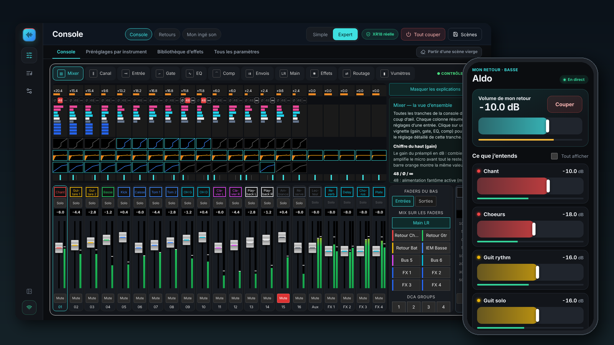
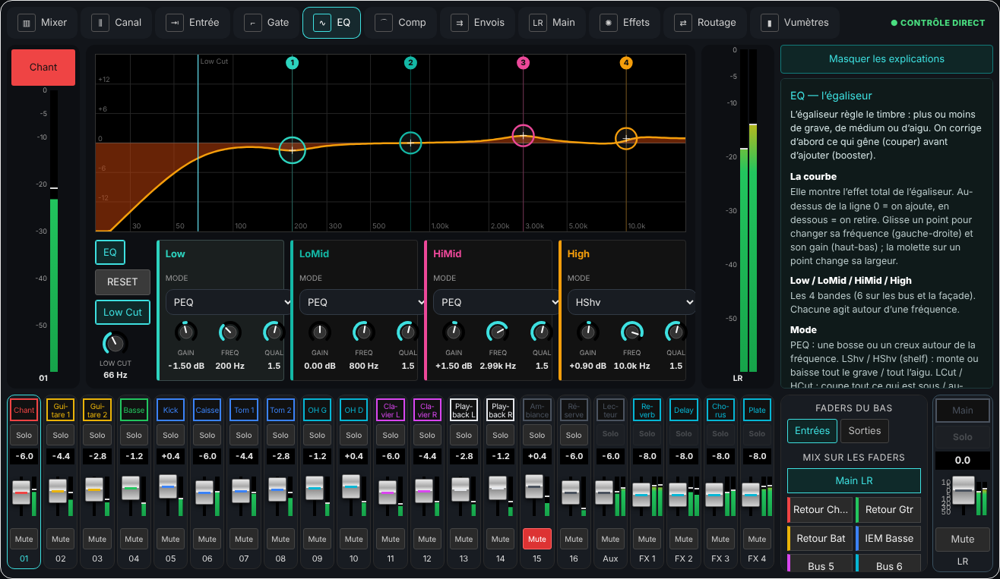
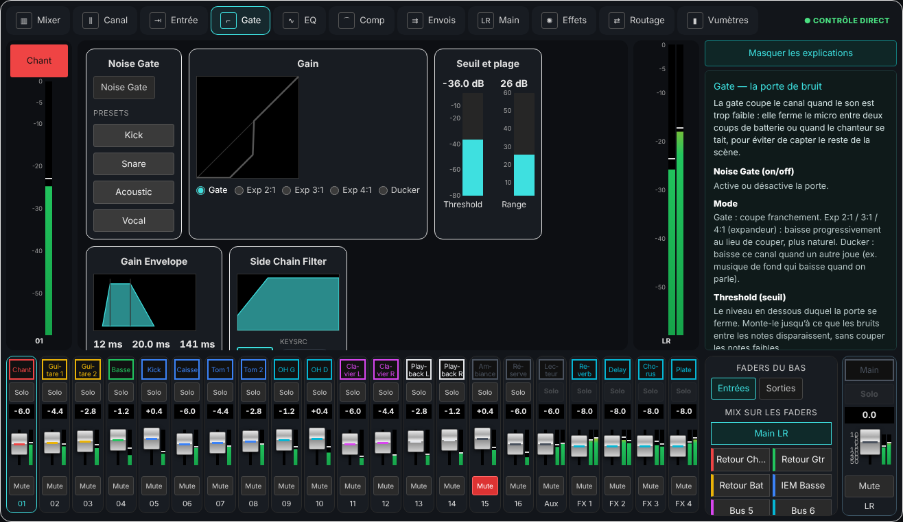
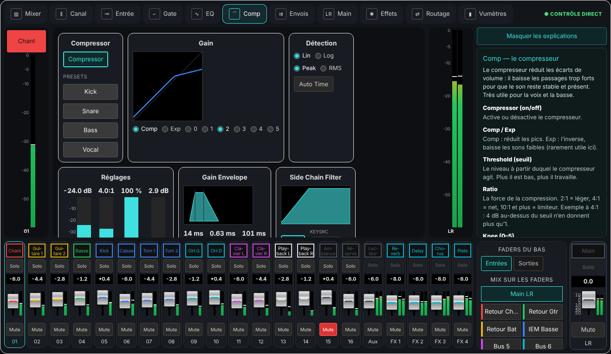
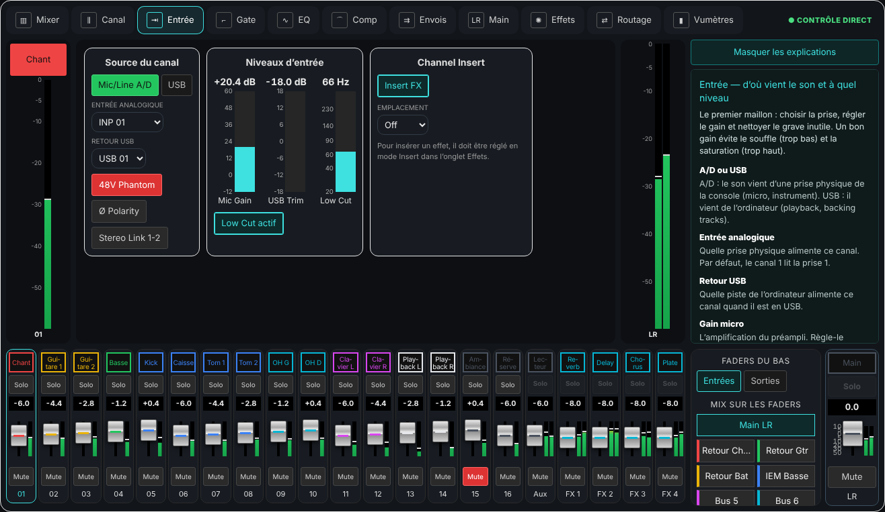
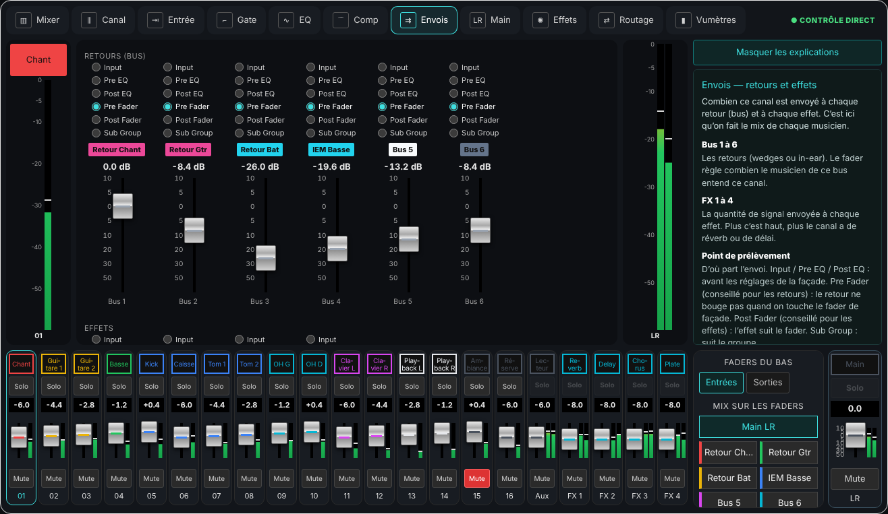
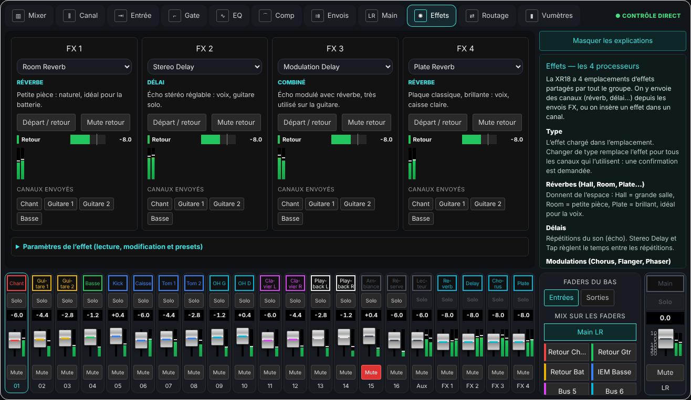
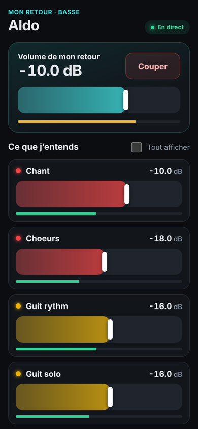

<div align="center">

# XR18 Studio

**Ton ingé son de poche pour la Behringer XR18**

[](https://github.com/herve8940/xr18-studio/releases/latest) [](https://github.com/herve8940/xr18-studio/releases) [](LICENSE) [](https://github.com/herve8940/xr18-studio/releases/latest)

Application **gratuite** pour piloter une table de mixage **Behringer XR18, X18 ou MR18**, alternative à X-AIR Edit pensée pour les débutants : un assistant qui te guide pas à pas, une console claire où toutes les pistes tiennent à l’écran, et le retour in-ear de chaque musicien sur son téléphone.

🇫🇷 Français · [🇬🇧 English](README.en.md)

[**⬇️ Télécharger**](https://github.com/herve8940/xr18-studio/releases/latest) · [**🌐 Site**](https://herve8940.github.io/xr18-studio/) · [**📘 Tuto « Mon ingé son »**](docs/TUTO_MON_INGE_SON.md) · [Guide complet](docs/USER_GUIDE_FR.md) · [Nouveautés](docs/RELEASE_NOTES.md)



Windows · macOS (Intel et Apple Silicon) · Linux · fonctionne aussi avec X18 et MR18

</div>

---

## Pour qui ?

Pour les **groupes sans ingé son** : répétitions, petites salles, bars, fêtes… Tu as une XR18, des micros, des musiciens, et tu veux que ça sonne **sans apprendre le jargon**.

XR18 Studio se pose sur ta console comme X-AIR Edit, avec en plus :

| 🎧 **Mon ingé son** | 🎚️ **Une console claire** | 📱 **Les retours au téléphone** |
|---|---|---|
| Un assistant en 6 étapes : il configure chaque instrument selon les bonnes pratiques, règle les gains avec toi et prépare les retours. | Un mode **Simple** avec de gros faders pour le concert, un mode **Expert** complet façon X-AIR Edit, chaque option expliquée. | Chaque musicien scanne son QR code et règle **son** retour. Il n’a aucune application à installer et ne peut toucher à rien d’autre. |

## 🎧 Mon ingé son, en 6 étapes

| 1. Choisis tes instruments | 2. Règle les gains | 3. Prépare les retours |
|---|---|---|
|  |  |  |
| Chant, guitare rythmique et solo, basse, batterie détaillée (kick, snare, 3 toms, 2 overheads)… Choisir un instrument propose sa **configuration complète** : coupe-bas, égaliseur, compresseur, gate, position stéréo. | Chaque musicien joue fort, seul. Le coach **mesure**, propose le bon gain, puis **cale le compresseur et le gate sur ton vrai signal**. | Un mix par musicien selon son rôle : le bassiste a basse et kick soudés, le batteur n’a pas les cymbales qu’il entend déjà. Puis les QR codes en un clic. |

**Rien ne change sans ton accord.** Chaque réglage passe par une fenêtre « avant / après », une sauvegarde est faite, et un bouton annule tout.

👉 **[Le tuto illustré pas à pas, pour débutants](docs/TUTO_MON_INGE_SON.md)**

## 🎚️ La console

| Mode Simple (concert) | Retour d’un musicien | Mode Expert (façon X-AIR Edit) |
|---|---|---|
|  |  |  |

| Égaliseur | Gate | Compresseur |
|---|---|---|
|  |  |  |
| **Entrée** | **Envois** | **Effets** |
|  |  |  |

- **Toutes les pistes à l’écran**, sans faire défiler : les tranches s’adaptent à la taille de la fenêtre (vérifié de 1280×800 à 1920×1080), le menu se replie tout seul.
- **Partir d’une scène vierge** en un clic : toute la console revient à neutre, volumes en bas, sans toucher au 48 V, aux gains ni au routage, avec retour en arrière.
- **Chaque vue explique** en langage simple ce que fait chaque bouton : voir le [guide de la console](docs/GUIDE_CONSOLE.md).

## 📱 Les retours sur le téléphone

| Les QR codes des musiciens | La page du musicien |
|---|---|
|  |  |

Chaque lien est **personnel** : le musicien ne voit que son propre retour. Le volume est plafonné pour protéger les oreilles. Un lien perdu se remplace en un clic.

## ⬇️ Installer

Télécharge le fichier de ton ordinateur sur la [**page des versions**](https://github.com/herve8940/xr18-studio/releases/latest). Tout est inclus, il n’y a rien d’autre à installer.

| Ordinateur | Fichier |
|---|---|
| Windows | `XR18-Studio-Windows-….exe` |
| Mac Apple Silicon (M1, M2, M3…) | `XR18-Studio-macOS-…-arm64.dmg` |
| Mac Intel | `XR18-Studio-macOS-…-x64.dmg` |
| Ubuntu / Debian | `.deb` |
| Autre Linux | `.AppImage` |

Les installateurs ne sont pas signés par un certificat commercial :

- **Mac** : la première fois, fais **clic droit › Ouvrir**. Pour trouver la console, autorise ensuite le **Réseau local** dans *Réglages Système › Confidentialité et sécurité*.
- **Windows** : si SmartScreen s’affiche, clique **Informations complémentaires › Exécuter quand même**.

Détails : [installer l’application](docs/USER_GUIDE_FR.md#2-installer-lapplication).

## 🚀 Premiers pas en 5 minutes

1. Relie l’ordinateur et la XR18 au **même réseau** (Wi-Fi de la console ou routeur du groupe).
2. Ouvre XR18 Studio : la console est **trouvée toute seule**, comme dans X-AIR Edit.
3. Va dans **Jouer › Mon ingé son** et suis les étapes.

Pas de console sous la main ? Tout se découvre en **mode simulation**.

## 📚 Documentation

| | |
|---|---|
| 📘 [Tuto « Mon ingé son »](docs/TUTO_MON_INGE_SON.md) | Le parcours guidé, très illustré, pour débutants |
| 📗 [Guide complet](docs/USER_GUIDE_FR.md) | Installation, connexion, console, retours, scènes, dépannage |
| 🎚️ [Guide de la console](docs/GUIDE_CONSOLE.md) | Chaque option de chaque vue expliquée |
| 🔧 [Mon ingé son : détails techniques](docs/INGE_SON.md) | Valeurs par instrument, règles de calcul des gains et seuils |
| 🔌 [Connexion à la XR18](docs/CONNEXION_XR18.md) | Réseau, découverte, dépannage |
| 📝 [Nouveautés](docs/RELEASE_NOTES.md) · [État du projet](docs/ETAT_DU_PROJET.md) | Ce qui a changé, ce qui est vérifié |

## ⚠️ À savoir

- Le coach lit les **réglages et les niveaux** de la console, **pas le son** : ses conseils d’écoute partent de ta description.
- Les valeurs proposées sont des **points de départ** issus des bonnes pratiques du live : ton oreille a le dernier mot.
- Fais toujours un essai complet sur ta console **avant un concert**.

<details>
<summary><b>Pour les développeurs</b></summary>

```sh
npm run setup      # dépendances
npm run studio     # serveur + interface en local
npm test           # tests
npm run build:all  # backend et interface
npm run desktop:package
```

Les installateurs sont produits par GitHub Actions : le workflow « Desktop packages » à chaque PR, et le workflow « Release » quand la version de `package.json` change sur `main`.

- Le moteur OSC est unique : l’interface, les pages des musiciens et MCP passent par son API et ses droits.
- Une connexion ou une lecture ne change jamais le mixage.
- Les gestes de la console sont envoyés immédiatement, puis relus sur la XR18.
- Le 48 V, le routage et les types d’effets passent par prévisualisation et confirmation.

Références : [alignement sur X-AIR Edit et protocole OSC](docs/XAIR_EDIT_PARITY.md) · [fonctions, HTTPS, ReaCue et MCP](docs/FONCTIONS_0_2.md) · [installation de bureau](docs/INSTALLATION_CLE_EN_MAIN.md) · [application multiplateforme](docs/DESKTOP_MULTIPLATEFORME.md)

</details>

---

<div align="center">
XR18 Studio est un logiciel libre sous <a href="LICENSE">licence MIT</a>, par Hervé Naessens.<br>Projet indépendant, non affilié à Behringer / Music Tribe. XR18, X18, MR18 et X-AIR sont des marques de leurs propriétaires.
</div>
