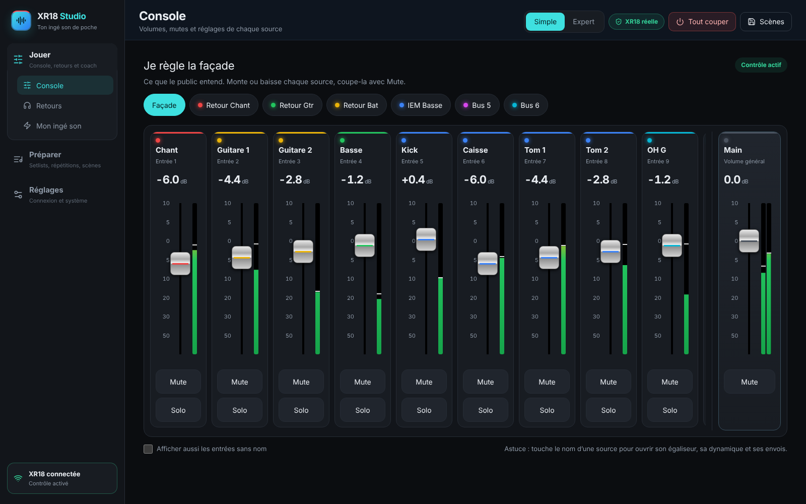

# XR18 Studio 1.3

[🇫🇷 Guide utilisateur illustré](docs/USER_GUIDE_FR.md) · [🇬🇧 Illustrated user guide](docs/USER_GUIDE_EN.md) · [Notes de version / Release notes](docs/RELEASE_NOTES.md) · [Télécharger / Download](https://github.com/herve8940/xr18-studio-/releases/latest)

**FR** — Assistant de mixage pour Behringer XR18 (ainsi que X18 et MR18) : console graphique dans l’esprit de X-AIR Edit, parcours guidé, retours, effets et scènes. Installateurs autonomes Windows, Mac Intel / Apple Silicon et Linux. Interface en français ; guides bilingues. La validation sur une console physique reste nécessaire avant un concert.

**EN** — Mixing assistant for Behringer XR18 (and X18 / MR18): X-AIR Edit–style graphical console, guided workflow, monitors, effects and scenes. Self-contained Windows, Intel / Apple Silicon Mac and Linux installers. French interface; bilingual guides. Physical console validation is still required before a show.



## Nouveautés 1.3 / What’s new in 1.3

- **Nouvelle interface sombre et moderne** : trois espaces (Jouer, Préparer, Réglages), console en mode **Simple** (gros faders au doigt, façade ou retour d’un musicien) ou **Expert**, adaptée à l’ordinateur, la tablette et le téléphone.
- **Console graphique façon X-AIR Edit** (mode Expert) : onglets Mixer, Canal, Entrée, Gate, EQ, Comp, Envois, Main, Effets, Routage et Vumètres, avec la banque de faders en bas et la barre de mix à droite.
- **Explications intégrées** : chaque vue explique en langage simple ce que fait chaque option. Voir le [guide de la console](docs/GUIDE_CONSOLE.md).
- **Faders par mix** (« sends on fader ») pour faire le retour de chaque musicien.
- **Corrections issues de la comparaison avec X-AIR Edit 1.8.1** : les écritures ne sont plus refusées à tort, l’affichage dB est exact, les 40 vumètres sont lus, X18 et MR18 sont reconnues. Détails : [XAIR_EDIT_PARITY](docs/XAIR_EDIT_PARITY.md).

| Égaliseur | Gate | Entrée |
|---|---|---|
|  |  |  |
| **Compresseur** | **Envois** | **Effets** |
|  |  |  |

---

## Développement / Development

```sh
npm run setup
npm run studio
```

Backend et interface compilés : `npm run build:all`. Application de bureau : `npm run desktop:package`. Les installateurs sont produits par GitHub Actions : le workflow « Desktop packages » à chaque PR, et le workflow « Release » quand la version de `package.json` change sur `main`.

- [Guide utilisateur (FR)](docs/USER_GUIDE_FR.md) · [User guide (EN)](docs/USER_GUIDE_EN.md)
- [Guide de la console : chaque option expliquée](docs/GUIDE_CONSOLE.md)
- [Alignement sur X-AIR Edit et protocole OSC](docs/XAIR_EDIT_PARITY.md)
- [Mon ingé son : parcours guidé et dialogue](docs/INGE_SON.md)
- [État vérifié et limites](docs/ETAT_DU_PROJET.md)
- [Guide des fonctions, HTTPS, ReaCue et MCP](docs/FONCTIONS_0_2.md)
- [Connexion en un clic](docs/CONNEXION_XR18.md)
- [Installation de bureau](docs/INSTALLATION_CLE_EN_MAIN.md)

Le moteur OSC est unique : l’interface, les clients musiciens et MCP passent par son API et ses droits. Une connexion ou une lecture ne change pas le mixage.

La console graphique envoie chaque geste immédiatement par WebSocket, puis relit la valeur retenue par la console. Le 48 V, le routage et le changement d’algorithme FX restent dans le flux prévisualisation et confirmation. Les scènes natives `.scn` avec FX textuels opaques restent archivables mais pas rappelables ; les scènes complètes JSON version 2 conservent directement les vecteurs OSC typés.

L’accueil ouvre le mode guidé « Mon ingé son » : préparation du groupe, balance pas à pas, conseils en langage courant, prévisualisation et annulation. Le conseiller local fonctionne sans clé API. Le dialogue OpenAI facultatif nécessite une configuration et un accord d’envoi ; il ne pilote jamais directement la console.
