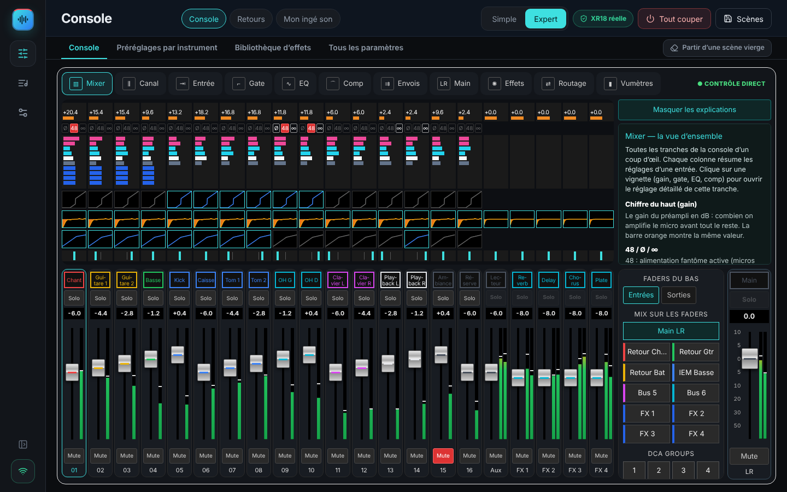

# XR18 Studio 2.0 bêta

[🇫🇷 Guide utilisateur illustré](docs/USER_GUIDE_FR.md) · [🇬🇧 Illustrated user guide](docs/USER_GUIDE_EN.md) · [Télécharger / Download](https://github.com/herve8940/xr18-studio-/releases/latest)

**Version en préparation : 2.0.0-beta.3.** [Périmètre et limites de la version 2](docs/RELEASE_2_0.md). La couverture complète des fonctions XR18 n’est pas encore atteinte.

**FR** — Assistant de mixage pour Behringer XR18 : parcours guidé, console, retours, effets et scènes. Installateurs autonomes Windows, Mac Intel / Apple Silicon et Linux. Interface en français ; guides bilingues. Voir les [notes et limites de la 1.0](docs/RELEASE_1_0.md), notamment la validation matérielle encore nécessaire.

**EN** — Behringer XR18 mixing assistant with a guided workflow, console, monitors, effects and scenes. Self-contained Windows, Intel / Apple Silicon Mac and Linux installers. French interface; bilingual guides. Read the [1.0 release notes and limitations](docs/RELEASE_1_0.md), including pending physical hardware validation.



---

## Développement / Development

Application de mixage XR18 pour Windows, macOS et Linux : simulation, connexion OSC, contrôles de console, scènes, effets, retours personnels, répétitions, ReaCue et MCP.

Version 2.0.0-beta.3 : commandes organisées par traitement, copie sélective entre canaux et inventaire des fonctions. Validation sur la console physique requise avant utilisation en concert.

```sh
npm run setup
npm run studio
```

Backend et interface compilés : `npm run build:all`. Application de bureau : `npm run desktop:package`. Les installateurs sont produits par GitHub Actions.

- [Mon ingé son : parcours guidé et dialogue](docs/INGE_SON.md)
- [État vérifié et limites](docs/ETAT_DU_PROJET.md)
- [Guide des fonctions, HTTPS, ReaCue et MCP](docs/FONCTIONS_0_2.md)
- [Connexion en un clic](docs/CONNEXION_XR18.md)
- [Installation de bureau](docs/INSTALLATION_CLE_EN_MAIN.md)

Le moteur OSC est unique ; l’interface, les clients musiciens et MCP passent par son API et ses droits. Une connexion ou une lecture ne change pas le mixage. Les scènes natives `.scn` avec FX textuels opaques restent archivables, mais leur rappel est refusé ; les scènes complètes JSON version 2 conservent directement les vecteurs OSC typés.

L’accueil ouvre le mode guidé « Mon ingé son » : préparation du groupe, balance pas à pas, conseils en langage courant, prévisualisation et annulation. Le conseiller local fonctionne sans clé API. Le dialogue OpenAI facultatif nécessite une configuration et un accord d’envoi ; il ne pilote jamais directement la console.
