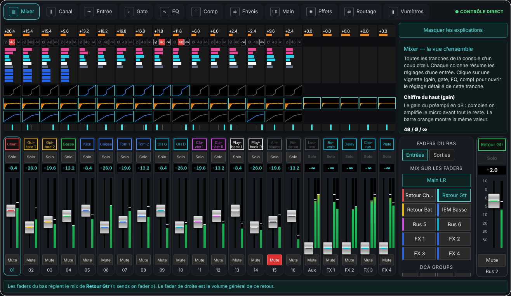
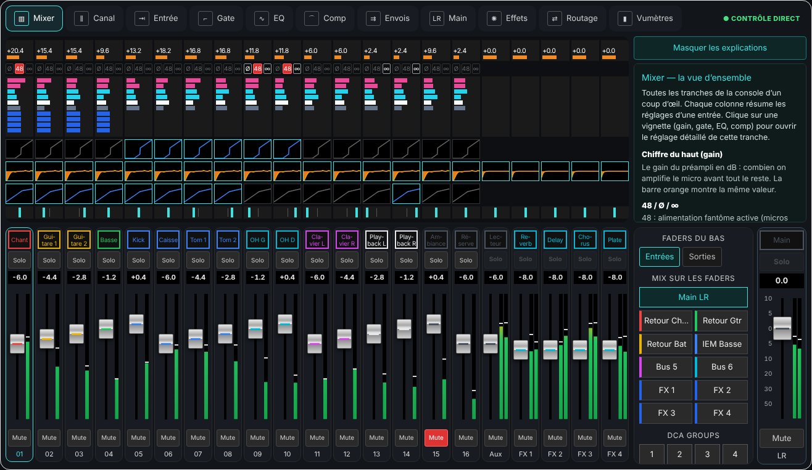
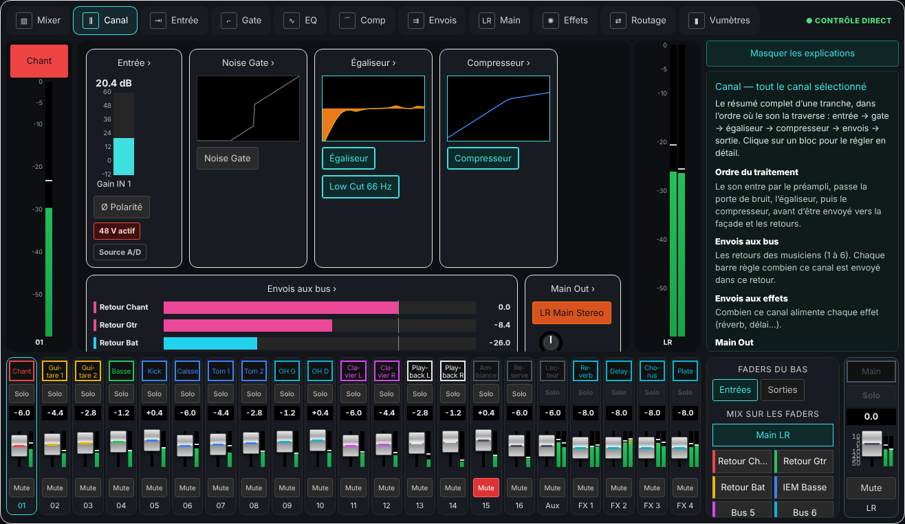
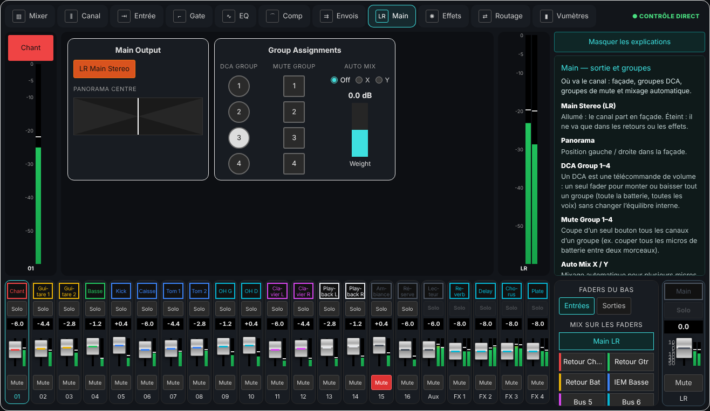
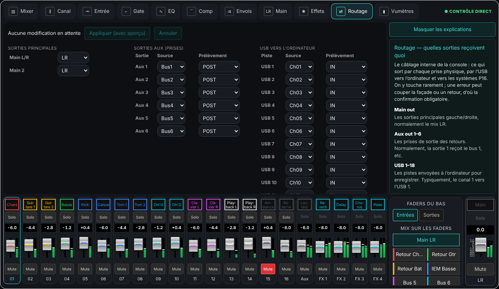
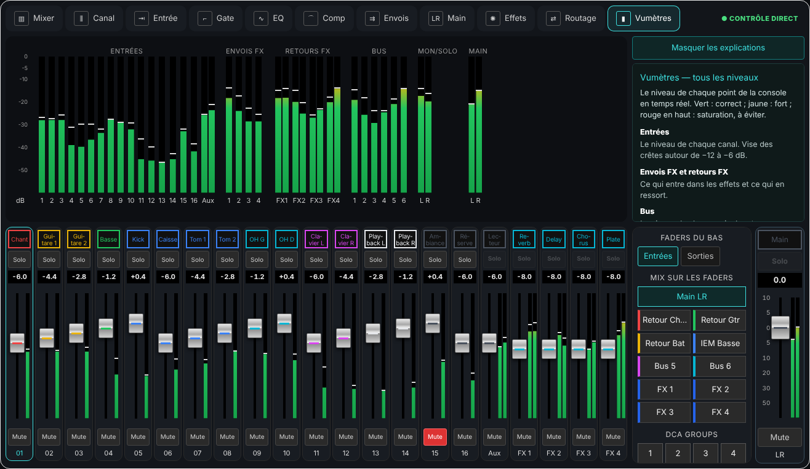

# Guide de la console XR18 Studio — chaque option expliquée simplement

[Guide utilisateur](USER_GUIDE_FR.md) · [Accueil](https://github.com/herve8940/xr18-studio)

Ce guide décrit chaque vue de la console en mode **Expert** (Jouer › Console, bouton **Expert** en haut) et ce que fait chaque réglage, en langage de musicien. Les mêmes explications sont dans l’application : bouton **? Explications** à droite de chaque vue. Survoler un réglage affiche aussi une courte description.

La console reprend l’organisation de X-AIR Edit : les onglets en haut, la vue du canal sélectionné au milieu, la banque de faders en bas et la barre de réglages à droite.

## Avant de commencer : les gestes

- **Glisser** un fader, une barre ou un bouton rotatif pour le régler. Maintenir **Maj** pour un réglage fin.
- La **molette** de la souris ajuste par petits pas.
- Un **double-clic** remet la valeur par défaut.
- Avec le clavier, les **flèches** règlent le contrôle sélectionné.
- Chaque geste part tout de suite vers la XR18, puis la valeur réellement retenue par la console est relue.
- Le **48 V**, le **routage** et le **changement d’effet** demandent toujours une confirmation, avec aperçu et sauvegarde.

## La banque de faders (en bas)

- **Nom coloré** : Clique pour sélectionner la tranche : les vues du haut montrent alors ses réglages.
- **Solo** : Écoute ce canal seul au casque, sans rien changer pour le public.
- **Chiffre** : Le niveau du fader en dB. 0 = niveau nominal, −∞ = coupé.
- **Fader** : Le volume du canal dans le mix choisi à droite (façade ou retour).
- **Mute** : Coupe le canal (rouge = coupé).

**La barre de droite :**

- **Faders du bas, Entrées / Sorties** : afficher les canaux, ou les masters des bus, envois FX et DCA.
- **Mix sur les faders** : *Main LR* = mix de la façade. Un nom de bus (ex. « Retour Chant ») = les faders deviennent les envois vers ce retour : c’est la façon la plus simple de faire le mix d’un musicien. *FX 1–4* = les envois vers l’effet.
- **DCA Groups 1–4** : n’afficher que les canaux d’un DCA. Recliquer pour tout revoir.
- **Clr Solo** : arrête tous les solos.
- **Mute Groups 1–4** : coupe d’un coup tous les canaux d’un groupe (rouge = coupé).
- **Auto Mix X / Y** : active le mixage automatique des micros parlés.

## Mixer

Toutes les tranches de la console d’un coup d’œil. Chaque colonne résume les réglages d’une entrée. Clique sur une vignette (gain, gate, EQ, comp) pour ouvrir le réglage détaillé de cette tranche.

| Option | À quoi ça sert |
|---|---|
| **Chiffre du haut (gain)** | Le gain du préampli en dB : combien on amplifie le micro avant tout le reste. La barre orange montre la même valeur. |
| **48 / Ø / ∞** | 48 : alimentation fantôme active (micros statiques). Ø : polarité inversée. ∞ : canal couplé en stéréo avec son voisin. |
| **Barres de couleur** | Les envois vers les retours (bus 1 à 6) puis vers les effets (FX 1 à 4). Plus la barre est longue, plus le musicien entend ce canal dans son retour, ou plus l’effet en reçoit. |
| **Vignette gate** | La forme de la porte de bruit. Allumée en bleu si elle est active. |
| **Vignette EQ** | La courbe de l’égaliseur, en orange si active. |
| **Vignette comp** | La courbe du compresseur, en bleu si actif. |
| **Barre de pan** | Position gauche / droite dans la façade. |

## Canal

Le résumé complet d’une tranche, dans l’ordre où le son la traverse : entrée → gate → égaliseur → compresseur → envois → sortie. Clique sur un bloc pour le régler en détail.

| Option | À quoi ça sert |
|---|---|
| **Ordre du traitement** | Le son entre par le préampli, passe la porte de bruit, l’égaliseur, puis le compresseur, avant d’être envoyé vers la façade et les retours. |
| **Envois aux bus** | Les retours des musiciens (1 à 6). Chaque barre règle combien ce canal est envoyé dans ce retour. |
| **Envois aux effets** | Combien ce canal alimente chaque effet (réverb, délai…). |
| **Main Out** | Si le canal part en façade (LR) et sa position gauche/droite. |

## Entrée

Le premier maillon : choisir la prise, régler le gain et nettoyer le grave inutile. Un bon gain évite le souffle (trop bas) et la saturation (trop haut).

| Option | À quoi ça sert |
|---|---|
| **A/D ou USB** | A/D : le son vient d’une prise physique de la console (micro, instrument). USB : il vient de l’ordinateur (playback, backing tracks). |
| **Entrée analogique** | Quelle prise physique alimente ce canal. Par défaut, le canal 1 lit la prise 1. |
| **Retour USB** | Quelle piste de l’ordinateur alimente ce canal quand il est en USB. |
| **Gain micro** | L’amplification du préampli. Règle-le pendant que le musicien joue fort : le vumètre doit monter vers −12 / −6 dB sans toucher le rouge. Attention : il agit sur la prise physique, donc sur tous les canaux qui l’utilisent, retours compris. |
| **Trim USB** | L’équivalent du gain pour une source USB : monte ou baisse le niveau venant de l’ordinateur. |
| **48 V (phantom)** | Alimentation nécessaire aux micros statiques et à certaines DI actives. Inutile, voire risquée, pour un micro à ruban ou un instrument branché directement. Elle demande toujours une confirmation. |
| **Polarité Ø** | Inverse le signal. Utile quand deux micros captent la même source (caisse claire dessus/dessous, kick in/out) et que le son devient creux : essaie d’inverser l’un des deux. |
| **Stereo Link** | Couple ce canal avec son voisin (1-2, 3-4…) pour régler une source stéréo (clavier, playback) d’un seul geste. |
| **Low Cut (coupe-bas)** | Supprime le grave sous la fréquence choisie : bruits de manipulation, vent, ronflement de scène. 80–100 Hz pour une voix ou une guitare, plus bas (30–40 Hz) pour une basse ou un kick. |
| **Insert FX** | Place un effet directement dans le canal (au lieu de l’envoyer). Réservé aux effets d’insertion comme un égaliseur graphique ou un compresseur spécial. |

## Gate

La gate coupe le canal quand le son est trop faible : elle ferme le micro entre deux coups de batterie ou quand le chanteur se tait, pour éviter de capter le reste de la scène.

| Option | À quoi ça sert |
|---|---|
| **Noise Gate (on/off)** | Active ou désactive la porte. |
| **Mode** | Gate : coupe franchement. Exp 2:1 / 3:1 / 4:1 (expandeur) : baisse progressivement au lieu de couper, plus naturel. Ducker : baisse ce canal quand un autre joue (ex. musique de fond qui baisse quand on parle). |
| **Threshold (seuil)** | Le niveau en dessous duquel la porte se ferme. Monte-le jusqu’à ce que les bruits entre les notes disparaissent, sans couper les notes faibles. |
| **Range** | De combien on baisse quand la porte est fermée. 60 dB = silence total ; 10–20 dB = discret, plus naturel. |
| **Attack** | Vitesse d’ouverture. Très courte (0–2 ms) pour une batterie, plus lente pour éviter un clic sur une voix. |
| **Hold** | Temps pendant lequel la porte reste ouverte après que le son passe sous le seuil, pour ne pas hacher la fin des notes. |
| **Release** | Vitesse de fermeture. Plus long = fin de note plus douce. |
| **Side Chain Filter / KeySrc** | La porte « écoute » une version filtrée du son (ou un autre canal) pour décider quand s’ouvrir. Exemple : filtrer le grave pour qu’un tom ne soit pas ouvert par le kick. |
| **Presets** | Points de départ pour kick, caisse claire, guitare acoustique et voix. Ajuste ensuite le seuil à l’oreille. |

> 💡 Commence sans gate. Ajoute-la seulement si un micro capte trop les autres instruments.

## EQ

L’égaliseur règle le timbre : plus ou moins de grave, de médium ou d’aigu. On corrige d’abord ce qui gêne (couper) avant d’ajouter (booster).

| Option | À quoi ça sert |
|---|---|
| **La courbe** | Elle montre l’effet total de l’égaliseur. Au-dessus de la ligne 0 = on ajoute, en dessous = on retire. Glisse un point pour changer sa fréquence (gauche-droite) et son gain (haut-bas) ; la molette sur un point change sa largeur. |
| **Low / LoMid / HiMid / High** | Les 4 bandes (6 sur les bus et la façade). Chacune agit autour d’une fréquence. |
| **Mode** | PEQ : une bosse ou un creux autour de la fréquence. LShv / HShv (shelf) : monte ou baisse tout le grave / tout l’aigu. LCut / HCut : coupe tout ce qui est sous / au-dessus. VEQ : version « vintage », plus douce. |
| **Gain** | De combien on monte ou baisse, en dB. ±3 dB s’entend déjà. |
| **Freq** | La fréquence travaillée. Repères : 60–100 Hz = poids, 200–400 Hz = son boueux ou chaleureux, 1–3 kHz = présence, attaque, agressivité, 5–10 kHz = brillance, air, sifflantes. |
| **Q (qualité)** | La largeur de la bande. Q élevé = étroit et précis (supprimer un larsen), Q bas = large et musical. |
| **EQ / RESET** | Active l’égaliseur ou remet tous les gains à 0. |
| **Low Cut** | Le coupe-bas de l’entrée, rappelé ici car il fait partie de la courbe. |

> 💡 Voix étouffée : baisse un peu vers 300 Hz. Voix agressive : baisse vers 2–3 kHz. Pas de brillance : monte légèrement au-dessus de 8 kHz.

## Comp

Le compresseur réduit les écarts de volume : il baisse les passages trop forts pour que le son reste stable et présent. Très utile pour la voix et la basse.

| Option | À quoi ça sert |
|---|---|
| **Compressor (on/off)** | Active ou désactive le compresseur. |
| **Comp / Exp** | Comp : réduit les pics. Exp : l’inverse, baisse les sons faibles (rarement utile ici). |
| **Threshold (seuil)** | Le niveau à partir duquel le compresseur agit. Plus il est bas, plus il travaille. |
| **Ratio** | La force de la compression. 2:1 = léger, 4:1 = net, 10:1 et plus = limiteur. Exemple à 4:1 : 4 dB au-dessus du seuil n’en donnent plus qu’1. |
| **Knee (0–5)** | La douceur de l’entrée en action. 0 = brutal, 5 = très progressif et naturel. |
| **Gain (makeup)** | Rattrape le volume perdu par la compression. |
| **Mix** | Mélange son compressé et son d’origine (compression parallèle). 100 % = tout compressé. |
| **Attack** | Vitesse de réaction. Rapide = écrase l’attaque ; plus lent (10–30 ms) = laisse passer le claquant d’une batterie ou d’une basse. |
| **Hold / Release** | Combien de temps il continue d’agir et à quelle vitesse il relâche. Trop court = son qui « pompe ». |
| **Peak / RMS, Lin / Log** | Peak réagit aux pics instantanés, RMS au niveau moyen (plus doux). Lin / Log change la forme du relâchement : laisser par défaut si tu n’es pas sûr. |
| **Auto Time** | La console choisit attaque et relâchement selon le signal. Bon choix par défaut. |
| **Side Chain Filter** | Le compresseur ignore une partie du spectre pour décider quand agir (ex. ne pas réagir au grave d’une basse). |
| **Presets** | Points de départ pour kick, caisse claire, basse et voix. |

> 💡 Pour une voix : ratio 3:1, seuil réglé pour 3–6 dB de réduction sur les passages forts, attaque 10 ms, relâchement 100–150 ms.

## Envois

Combien ce canal est envoyé à chaque retour (bus) et à chaque effet. C’est ici qu’on fait le mix de chaque musicien.

| Option | À quoi ça sert |
|---|---|
| **Bus 1 à 6** | Les retours (wedges ou in-ear). Le fader règle combien le musicien de ce bus entend ce canal. |
| **FX 1 à 4** | La quantité de signal envoyée à chaque effet. Plus c’est haut, plus le canal a de réverb ou de délai. |
| **Point de prélèvement** | D’où part l’envoi. Input / Pre EQ / Post EQ : avant les réglages de la façade. Pre Fader (conseillé pour les retours) : le retour ne bouge pas quand on touche le fader de façade. Post Fader (conseillé pour les effets) : l’effet suit le fader. Sub Group : suit le groupe. |
| **−∞** | Rien n’est envoyé. |

> 💡 Pour régler vite le retour d’un musicien, choisis son bus dans la barre de droite : les faders du bas deviennent ses envois.

## Main

Où va le canal : façade, groupes DCA, groupes de mute et mixage automatique.

| Option | À quoi ça sert |
|---|---|
| **Main Stereo (LR)** | Allumé : le canal part en façade. Éteint : il ne va que dans les retours ou les effets. |
| **Panorama** | Position gauche / droite dans la façade. |
| **DCA Group 1–4** | Un DCA est une télécommande de volume : un seul fader pour monter ou baisser tout un groupe (toute la batterie, toutes les voix) sans changer l’équilibre interne. |
| **Mute Group 1–4** | Coupe d’un seul bouton tous les canaux d’un groupe (ex. couper tous les micros de batterie entre deux morceaux). |
| **Auto Mix X / Y** | Mixage automatique pour plusieurs micros parlés (conférence, théâtre) : la console baisse les micros inutilisés. À activer aussi dans la barre de droite. |
| **Weight** | Priorité d’un micro dans l’auto-mix. |

## Effets

La XR18 a 4 emplacements d’effets partagés par tout le groupe. On y envoie des canaux (réverb, délai…) depuis les envois FX, ou on insère un effet dans un canal.

| Option | À quoi ça sert |
|---|---|
| **Type** | L’effet chargé dans l’emplacement. Changer de type remplace l’effet pour tous les canaux qui l’utilisent : une confirmation est demandée. |
| **Réverbes (Hall, Room, Plate…)** | Donnent de l’espace : Hall = grande salle, Room = petite pièce, Plate = brillant, idéal pour la voix. |
| **Délais** | Répétitions du son (écho). Stereo Delay et Tap règlent le temps entre les répétitions. |
| **Modulations (Chorus, Flanger, Phaser)** | Épaississent ou font tourner le son, souvent sur guitare ou clavier. |
| **Insert** | L’emplacement est utilisé directement dans un canal au lieu d’être en départ/retour. |
| **Retour FX** | Le fader « FX » de la banque règle le volume de l’effet dans la façade. |
| **Paramètres** | Le détail de l’effet (taille, durée…), modifiable dans « Paramètres de l’effet » avec aperçu et confirmation. |

> 💡 Une seule bonne réverb pour les voix et une autre pour la batterie suffisent souvent.

### Les 61 effets disponibles

| Effet | Famille | Utilité |
|---|---|---|
| Hall Reverb (`HALL`) | Réverbe | Grande salle de concert, longue et ample. Ballades, voix, pads. |
| Ambience (`AMBI`) | Réverbe | Ambiance courte et discrète qui donne juste un peu d’air. |
| Rich Plate Reverb (`RPLT`) | Réverbe | Plaque riche et brillante, très flatteuse sur la voix. |
| Room Reverb (`ROOM`) | Réverbe | Petite pièce : naturel, idéal pour la batterie. |
| Chamber Reverb (`CHAM`) | Réverbe | Chambre d’écho : dense et chaleureuse. |
| Plate Reverb (`PLAT`) | Réverbe | Plaque classique, brillante : voix, caisse claire. |
| Vintage Reverb (`VREV`) | Réverbe | Réverbe d’époque au caractère marqué. |
| Vintage Room (`VRM`) | Réverbe | Pièce vintage, courte et colorée. |
| Gated Reverb (`GATE`) | Réverbe | Réverbe coupée net : caisse claire années 80. |
| Reverse Reverb (`RVRS`) | Réverbe | Réverbe inversée qui monte avant le son. Effet spécial. |
| Stereo Delay (`DLY`) | Délai | Écho stéréo réglable : voix, guitare solo. |
| 3-Tap Delay (`3TAP`) | Délai | Trois répétitions placées librement. |
| Rhythm Delay (`4TAP`) | Délai | Écho rythmique à quatre répétitions. |
| Stereo Chorus (`CRS`) | Modulation | Double et élargit le son : guitare claire, clavier. |
| Stereo Flanger (`FLNG`) | Modulation | Effet de « réacteur » qui balaie le son. |
| Stereo Phaser (`PHAS`) | Modulation | Effet tournant doux, typique des claviers et guitares. |
| Dimensional Chorus (`DIMC`) | Modulation | Chorus très subtil qui élargit sans se faire entendre. |
| Mood Filter (`FILT`) | Modulation | Filtre qui bouge (wah automatique). |
| Rotary Speaker (`ROTA`) | Modulation | Imite le haut-parleur tournant d’un orgue. |
| Tremolo / Panner (`PAN`) | Modulation | Fait varier le volume ou balade le son gauche-droite. |
| Suboctaver (`SUB`) | Spécial | Ajoute une octave grave (basse, kick). |
| Delay + Chamber (`D/RV`) | Combiné | Écho suivi d’une réverbe. |
| Chorus + Chamber (`CR/R`) | Combiné | Chorus suivi d’une réverbe. |
| Flanger + Chamber (`FL/R`) | Combiné | Flanger suivi d’une réverbe. |
| Delay + Chorus (`D/CR`) | Combiné | Écho et chorus ensemble. |
| Delay + Flanger (`D/FL`) | Combiné | Écho et flanger ensemble. |
| Modulation Delay (`MODD`) | Combiné | Écho modulé avec réverbe, très utilisé sur la guitare. |
| Dual Graphic EQ (`GEQ2`) | Égaliseur | Égaliseur graphique double, à insérer sur un bus de retour. |
| Stereo Graphic EQ (`GEQ`) | Égaliseur | Égaliseur graphique stéréo pour la façade : corriger la salle, chasser le larsen. |
| Dual TruEQ (`TEQ2`) | Égaliseur | Égaliseur graphique double plus précis. |
| Stereo TruEQ (`TEQ`) | Égaliseur | Égaliseur graphique stéréo plus précis. |
| Dual DeEsser (`DES2`) | Dynamique | Réduit les « s » sifflants, deux canaux. |
| Stereo DeEsser (`DES`) | Dynamique | Réduit les « s » sifflants d’une voix. |
| Stereo Xtec EQ1 (`P1A`) | Égaliseur | Égaliseur à lampes vintage (style Pultec) : grave rond, aigu soyeux. |
| Dual Xtec EQ1 (`P1A2`) | Égaliseur | Version double de l’égaliseur vintage. |
| Stereo Xtec EQ5 (`PQ5`) | Égaliseur | Égaliseur de médiums vintage. |
| Dual Xtec EQ5 (`PQ5S`) | Égaliseur | Version double de l’égaliseur de médiums vintage. |
| Wave Designer (`WAVD`) | Dynamique | Renforce ou adoucit l’attaque et la tenue (batterie). |
| Precision Limiter (`LIM`) | Dynamique | Limiteur : empêche de dépasser un niveau (protection). |
| Stereo Combinator (`CMB`) | Dynamique | Compresseur multibande pour la façade. |
| Dual Combinator (`CMB2`) | Dynamique | Compresseur multibande double. |
| Stereo Fair Compressor (`FAC`) | Dynamique | Compresseur à lampes vintage, très doux. |
| M/S Fair Compressor (`FAC1M`) | Dynamique | Compresseur vintage en mode milieu/côtés. |
| Dual Fair Compressor (`FAC2`) | Dynamique | Compresseur vintage double. |
| Stereo Leisure Compressor (`LEC`) | Dynamique | Compresseur optique vintage, idéal voix et basse. |
| Dual Leisure Compressor (`LEC2`) | Dynamique | Compresseur optique double. |
| Stereo Ultimo Compressor (`ULC`) | Dynamique | Compresseur rapide et punchy (style 1176). |
| Dual Ultimo Compressor (`ULC2`) | Dynamique | Version double du compresseur rapide. |
| Dual Enhancer (`ENH2`) | Spécial | Ajoute clarté et présence, deux canaux. |
| Stereo Enhancer (`ENH`) | Spécial | Ajoute clarté et présence. |
| Dual Exciter (`EXC2`) | Spécial | Ajoute de la brillance, deux canaux. |
| Stereo Exciter (`EXC`) | Spécial | Ajoute de la brillance. |
| Stereo Imager (`IMG`) | Spécial | Élargit ou resserre l’image stéréo. |
| Edison EX1 (`EDI`) | Spécial | Réglage fin de la largeur stéréo. |
| Sound Maxer (`SON`) | Spécial | Redonne de la définition à un son terne. |
| Dual Guitar Amp (`AMP2`) | Ampli | Simulation d’ampli guitare, deux canaux. |
| Stereo Guitar Amp (`AMP`) | Ampli | Simulation d’ampli guitare. |
| Dual Tube Stage (`DRV2`) | Ampli | Saturation à lampe, deux canaux. |
| Stereo Tube Stage (`DRV`) | Ampli | Saturation à lampe douce. |
| Dual Pitch Shifter (`PIT2`) | Spécial | Transpose le son (harmonies), deux voix. |
| Stereo Pitch Shifter (`PIT`) | Spécial | Transpose le son (harmonie, doublage). |

## Routage

Le câblage interne de la console : ce qui sort par chaque prise physique, par l’USB vers l’ordinateur et vers les systèmes P16. On y touche rarement ; une erreur peut couper la façade ou un retour, d’où la confirmation obligatoire.

| Option | À quoi ça sert |
|---|---|
| **Main out** | Les sorties principales gauche/droite, normalement le mix LR. |
| **Aux out 1–6** | Les prises de sortie des retours. Normalement, la sortie 1 reçoit le bus 1, etc. |
| **USB 1–18** | Les pistes envoyées à l’ordinateur pour enregistrer. Typiquement, le canal 1 vers l’USB 1. |
| **P16** | Les 16 canaux envoyés au système de retours personnels Behringer P16. |
| **Point de prélèvement (tap)** | À quel endroit du canal on prend le signal. Pour enregistrer « brut », choisir AIN ou IN (avant tout traitement). |

## Vumètres

Le niveau de chaque point de la console en temps réel. Vert : correct ; jaune : fort ; rouge en haut : saturation, à éviter.

| Option | À quoi ça sert |
|---|---|
| **Entrées** | Le niveau de chaque canal. Vise des crêtes autour de −12 à −6 dB. |
| **Envois FX et retours FX** | Ce qui entre dans les effets et ce qui en ressort. |
| **Bus** | Le niveau de chaque mix de retour. |
| **Main** | La sortie façade gauche/droite. |
| **Mon/Solo** | Ce qui part au casque ou aux écoutes de contrôle. |

## Repères rapides pour un groupe

| Problème | Où regarder | Quoi faire |
|---|---|---|
| Le vumètre touche le rouge | Entrée | Baisser le **Mic Gain**, pas le fader. |
| Un micro capte toute la batterie | Gate | Activer la gate, monter le **Threshold** jusqu’à couper les bruits entre les coups. |
| Voix étouffée, « boueuse » | EQ | Baisser un peu autour de 250–400 Hz. |
| Voix agressive ou qui « pique » | EQ | Baisser légèrement vers 2–4 kHz. |
| Voix qui disparaît puis explose | Comp | Ratio 3:1, seuil réglé pour 3–6 dB de réduction. |
| Un musicien ne s’entend pas | Mix sur les faders | Choisir son bus, monter son instrument, garder les envois en **Pre Fader**. |
| Trop de grave sur scène | Entrée | Activer le **Low Cut** (80–100 Hz) sur voix et guitares. |
| Larsen dans un retour | EQ du bus | Repérer la fréquence et la baisser avec un Q étroit. |

L’assistant ne reçoit pas le son : ces repères sont des points de départ, à valider à l’oreille.
