# Tuto « Mon ingé son » : faire sonner ton groupe, pas à pas

[🇬🇧 English version](TUTO_MON_INGE_SON_EN.md) · [Guide complet](USER_GUIDE_FR.md) · [Retour au projet](https://github.com/herve8940/xr18-studio)

Ce tuto est fait pour toi si **tu n’es pas ingé son** et que tu veux un bon son de groupe avec ta Behringer XR18, sans connaître le jargon. Tu suis 6 étapes dans l’ordre. Sur chaque capture, les **numéros orange** renvoient à la liste juste en dessous.

> **Durée** : environ 45 minutes la première fois, 15 minutes ensuite.
> **Il te faut** : la XR18 allumée et reliée au même réseau que l’ordinateur, les micros et instruments branchés, et les musiciens prêts à jouer.

## Les 3 règles d’or

| | |
|---|---|
| 🔒 **Rien ne change sans toi** | Avant chaque modification, une fenêtre te montre ce qui va changer. Tu acceptes ou tu annules. |
| ↩️ **Tout s’annule** | Le bouton **Annuler le dernier réglage guidé** remet tout comme avant. |
| 🔉 **Volumes bas au début** | Garde les enceintes et les in-ear bas pendant la préparation. Le coach ne touche jamais au 48 V. |

## Le parcours en un coup d’œil

| Étape | Ce que tu fais | Ce que fait le coach |
|---|---|---|
| **1. Brancher et connecter** | Tu relies la XR18 | Il vérifie que la console répond |
| **2. Dire qui est branché où** | Tu choisis l’instrument de chaque prise | Il prépare la configuration complète de chaque instrument |
| **3. Régler le gain** | Chaque musicien joue fort, seul | Il mesure, règle le gain et cale compresseur et gate |
| **4. Écouter et corriger** | Tu dis ce qui te gêne | Il propose une petite correction |
| **5. Préparer les retours** | Tu vérifies qui écoute quoi | Il prépare le retour de chaque musicien et ses QR codes |
| **6. Garder le bon réglage** | Tu donnes un nom | Il sauvegarde toute la balance |

---

## Avant de commencer : où trouver le coach

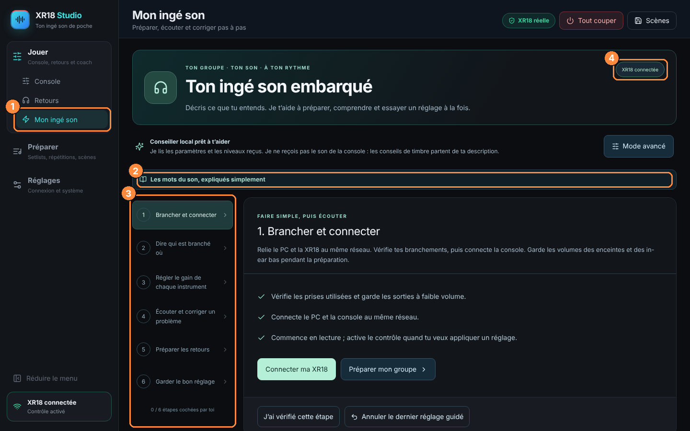

1. **Jouer › Mon ingé son** dans le menu de gauche.
2. **Les mots du son** : un lexique qui explique chaque mot technique en une phrase. Ouvre-le dès qu’un mot te bloque.
3. **Les 6 étapes**. Clique sur une étape pour y aller. Elles se cochent quand tu les valides.
4. **L’état de la console** : « XR18 connectée » ou « Entraînement sans console ».

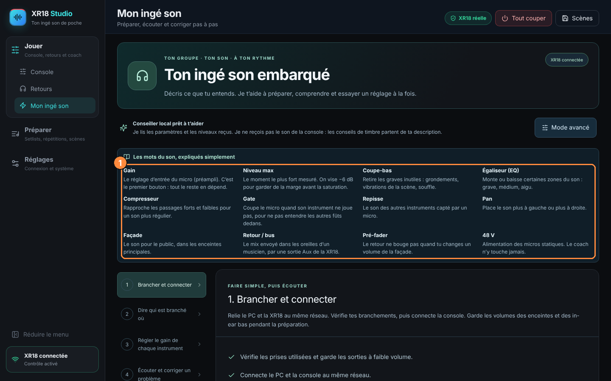

1. Gain, compresseur, gate, repisse, pré-fader… Chaque mot est expliqué simplement.

---

## Étape 1 : Brancher et connecter

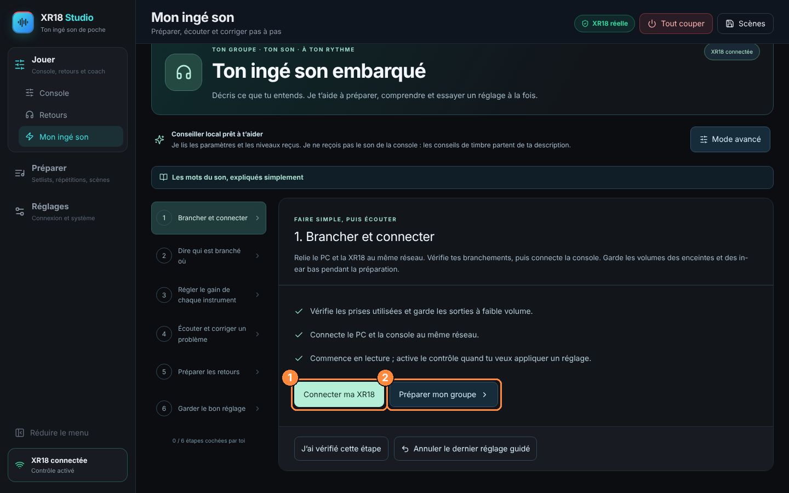

1. **Connecter ma XR18** t’amène à la page de connexion. L’application cherche la console toute seule, comme X-AIR Edit.
2. Une fois connecté, **Préparer mon groupe** passe à l’étape suivante.

> 💡 **Sur Mac**, si la console n’est pas trouvée : *Réglages Système › Confidentialité et sécurité › Réseau local*, puis autorise XR18 Studio.
> Sans console, tu peux tout découvrir en **simulation** : rien n’est mesuré ni inventé, mais tu vois tout le parcours.

---

## Étape 2 : Dire qui est branché où

### Choisir un modèle de groupe

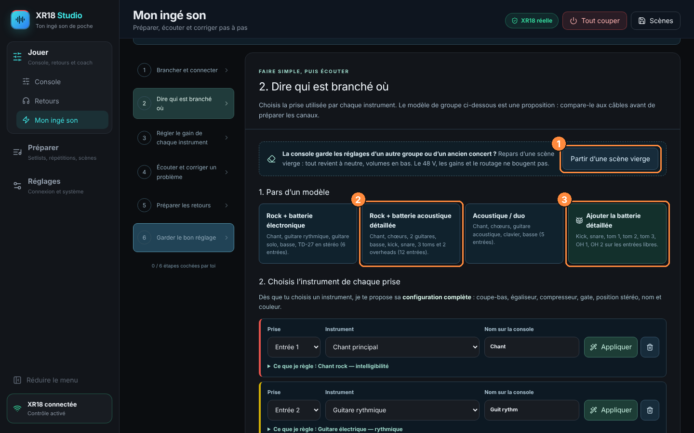

1. **Partir d’une scène vierge** (facultatif) : si la console garde les réglages d’un autre groupe ou d’un ancien concert, tout revient à neutre, volumes en bas. Le 48 V, les gains et le routage ne bougent pas.
2. **Choisis le modèle le plus proche de ton groupe.** Ici : rock avec batterie acoustique détaillée (chant, chœurs, 2 guitares, basse, kick, snare, 3 toms, 2 overheads).
3. **Ajouter la batterie détaillée** ajoute d’un coup kick, snare, tom 1, tom 2, tom 3, OH 1 et OH 2 sur les prises libres.

Rien n’est encore envoyé à la console : tu prépares juste la liste.

### Régler chaque instrument

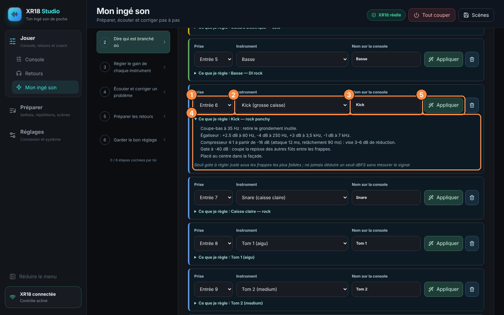

1. **Prise** : le numéro d’entrée de la XR18 où le câble est branché. Vérifie-le sur la table !
2. **Instrument** : dès que tu le choisis, le coach te propose **sa configuration complète**.
3. **Nom sur la console** : 12 caractères maximum. Il s’affiche dans X-AIR Edit et sur la console.
4. **Ce que je règle** : ce que fait chaque réglage, expliqué en clair (coupe-bas, égaliseur, compresseur, gate, position gauche/droite).
5. **Appliquer** envoie la configuration de **cet instrument seulement**.

### La fenêtre de vérification

À chaque fois, une fenêtre te montre ce qui va changer **avant** de toucher au son.

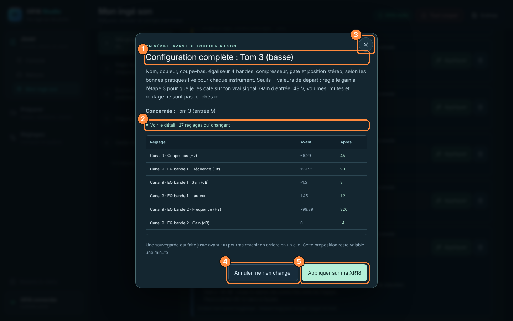

1. Ce qui va être fait, et pour quel instrument.
2. **Voir le détail** : la liste complète « avant / après », si tu es curieux.
3. **La croix** ferme sans rien changer. La touche Échap ou un clic à côté marchent aussi.
4. **Annuler, ne rien changer**.
5. **Appliquer sur ma XR18** envoie les réglages. Une sauvegarde est faite juste avant.

### Tout le groupe d’un coup

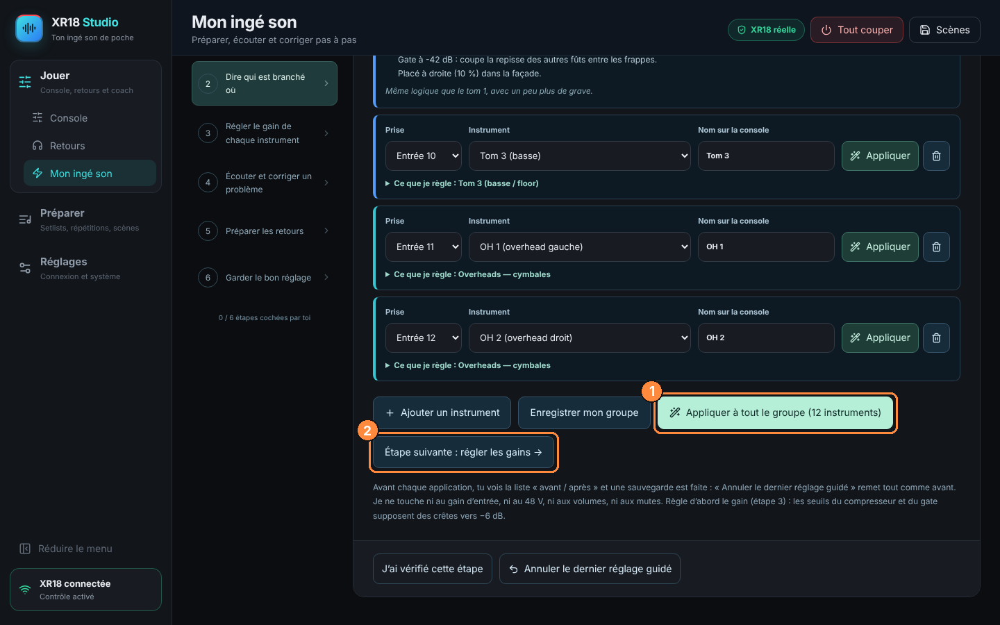

1. **Appliquer à tout le groupe** configure **tous** les instruments en une fois.
2. **Étape suivante : régler les gains** passe à l’étape la plus importante.

> ℹ️ Le coach règle le nom, la couleur, le coupe-bas, l’égaliseur, le compresseur, le gate et la position gauche/droite. Il ne touche **jamais** au gain (sauf à l’étape 3, avec ton accord), au 48 V, aux volumes, aux mutes ni au routage.

---

## Étape 3 : Régler le gain de chaque instrument

**C’est l’étape la plus importante.** Le gain est le premier bouton du son : le compresseur et le gate travaillent sur ce qui sort du préampli. Si le gain est faux, tout le reste l’est aussi.

### Le tableau de suivi

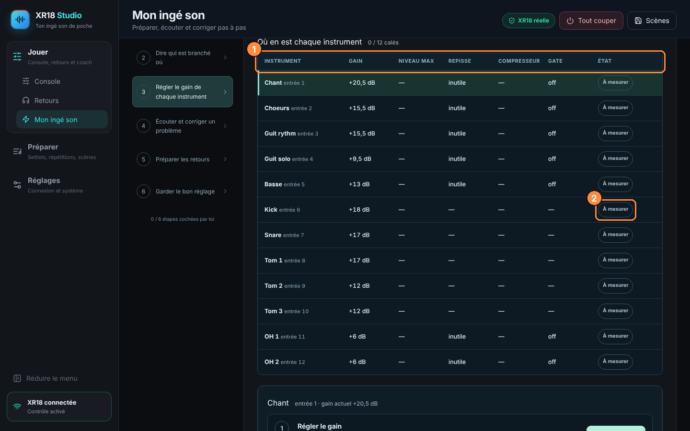

1. Pour chaque instrument : son gain, le niveau max mesuré, la repisse, et les seuils du compresseur et du gate.
2. **L’état** : **À mesurer**, **Calé** ou **Gain changé : à refaire**. Clique sur une ligne pour t’occuper de cet instrument.

### Mesurer et corriger le gain

Demande au musicien de jouer **seul**, au volume du **passage le plus fort du concert**.

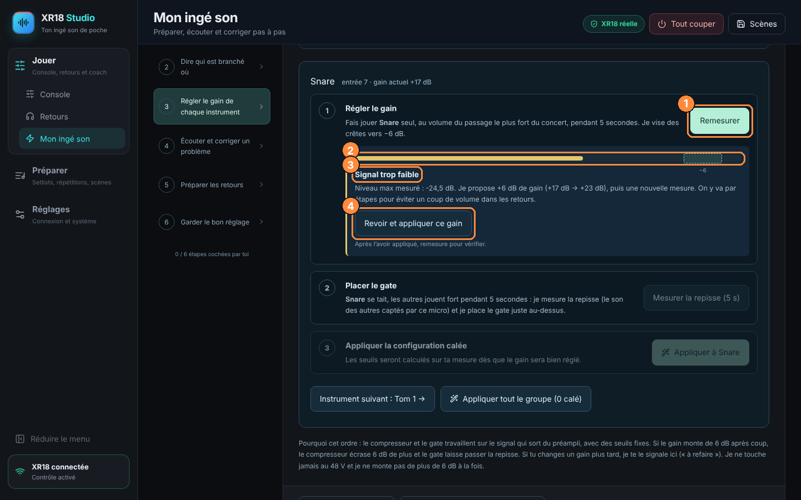

1. **Mesurer (5 s)** : le musicien joue pendant que le coach écoute les niveaux.
2. **La barre** montre le niveau max. La **zone en pointillés** est la cible, autour de −6 dB.
3. **Le verdict** : « Signal trop faible », « Ça sature » ou « Gain bien réglé ».
4. **Revoir et appliquer ce gain** ouvre la fenêtre de vérification. Après l’avoir appliqué, **remesure** : on y va par petites étapes, jamais plus de +6 dB à la fois.

Recommence jusqu’à voir **« Gain bien réglé »**.

### Placer le gate et appliquer

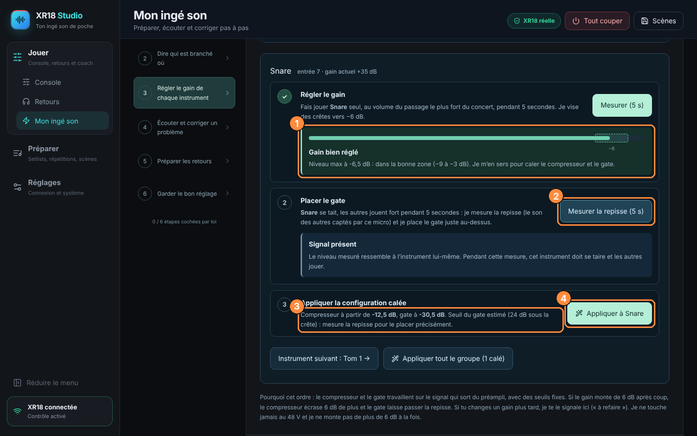

1. **Gain bien réglé** : le niveau est dans la zone. Le coach s’en sert pour la suite.
2. **Mesurer la repisse** (kick, snare et toms seulement) : cet instrument **se tait** et les autres jouent fort. Le coach mesure ce que le micro capte des autres et place le gate juste au-dessus.
3. **Les seuils calculés** sur ton vrai signal.
4. **Appliquer à …** envoie la configuration avec ces seuils.

Puis **Instrument suivant**, et ainsi de suite. À la fin, **Appliquer tout le groupe** utilise les seuils calés de chaque instrument.

> ⚠️ Si quelqu’un change un gain plus tard (sur la table ou dans X-AIR Edit), l’instrument repasse en **« à refaire »** : refais simplement sa mesure.
> Cette étape demande la **vraie XR18** et des musiciens qui jouent. En simulation, rien n’est mesuré.

---

## Étape 4 : Écouter et corriger

Faites jouer un morceau avec tout le groupe et écoute.

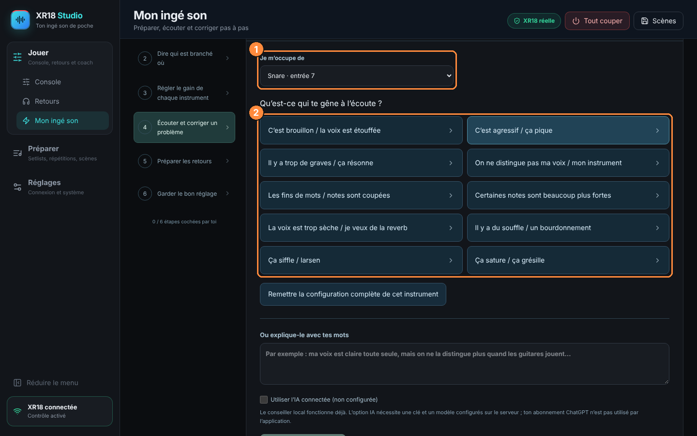

1. **Je m’occupe de** : choisis l’instrument concerné.
2. **Clique sur ce qui te gêne** : brouillon, agressif, trop de graves, on ne l’entend pas, ça siffle, ça sature… Le coach explique quoi vérifier et, si c’est utile, propose une **petite** correction que tu peux annuler.

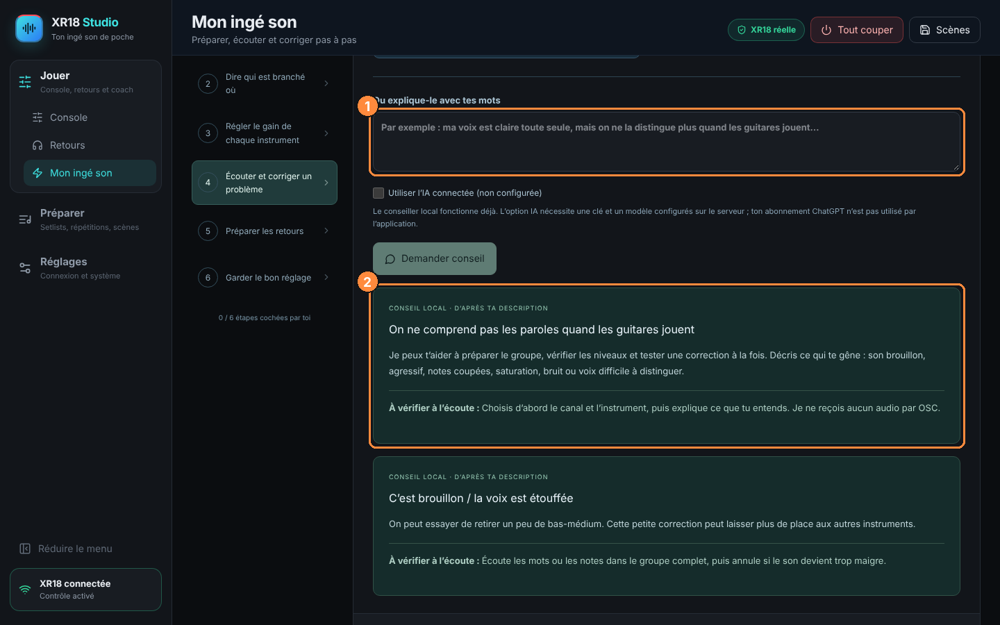

1. **Ou explique-le avec tes mots**, par exemple : « on ne comprend pas les paroles quand les guitares jouent ».
2. **La réponse** du coach, avec ce qu’il faut vérifier à l’écoute.

> 🛑 **Ça siffle (larsen) ?** Baisse tout de suite le volume concerné, ou utilise **Tout couper** en haut de l’écran. Ensuite seulement, cherche la cause.
> Le coach ne reçoit pas le son, seulement les réglages et les niveaux : ses conseils partent de ta description.

---

## Étape 5 : Préparer les retours de chaque musicien

Chaque musicien a **son propre mix** dans ses in-ear ou son retour, sur une sortie **Aux** de la XR18.

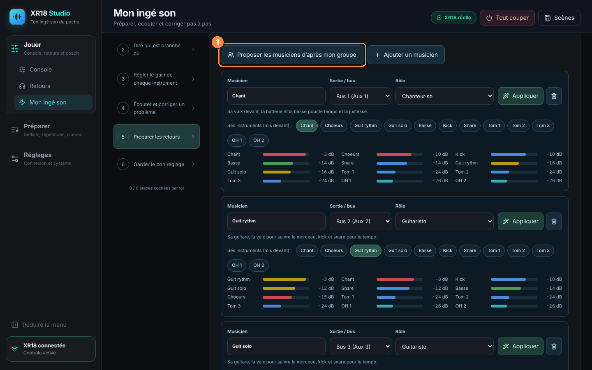

1. **Proposer les musiciens d’après mon groupe** : un musicien par instrument principal (chant, chaque guitare, basse, toute la batterie, clavier).

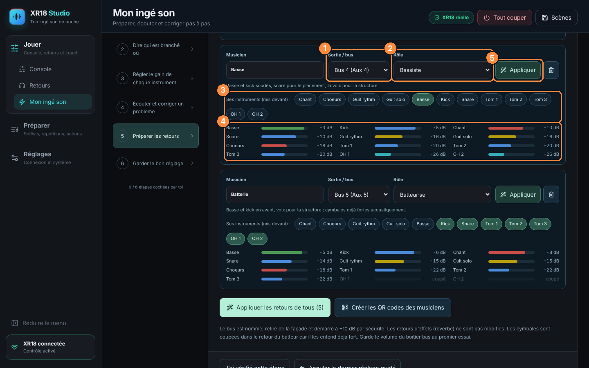

1. **Sortie / bus** : la sortie Aux où est branché son boîtier in-ear ou son retour.
2. **Rôle** : chanteur·se, guitariste, bassiste, batteur·se, claviériste. Le mix de départ dépend du rôle.
3. **Ses instruments** : ils sont mis **devant** dans son mix (clique pour ajouter ou retirer).
4. **Le mix de départ** qui sera envoyé, instrument par instrument. Par exemple, le bassiste a basse et kick soudés. Le batteur n’a pas les cymbales : il les entend déjà fort.
5. **Appliquer** envoie le retour de ce musicien.

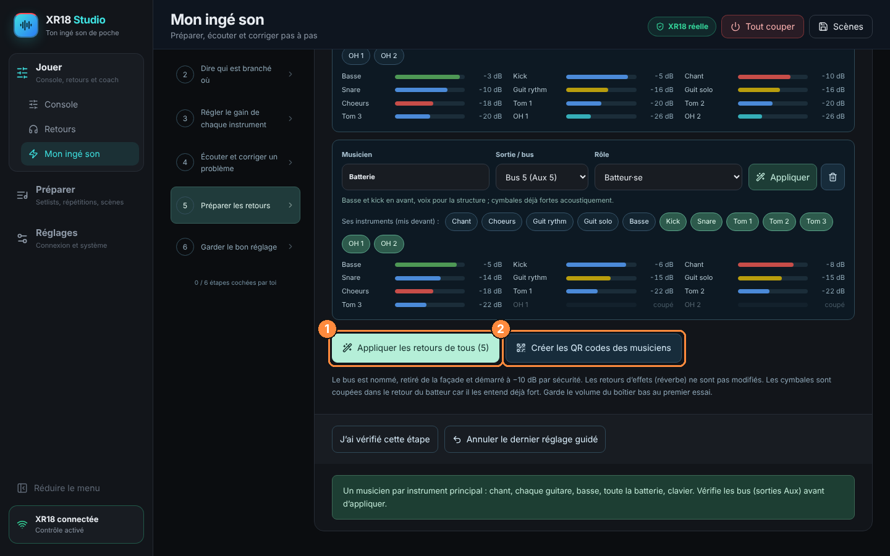

1. **Appliquer les retours de tous**.
2. **Créer les QR codes des musiciens** : un lien personnel par musicien. La page **Retours** s’ouvre.

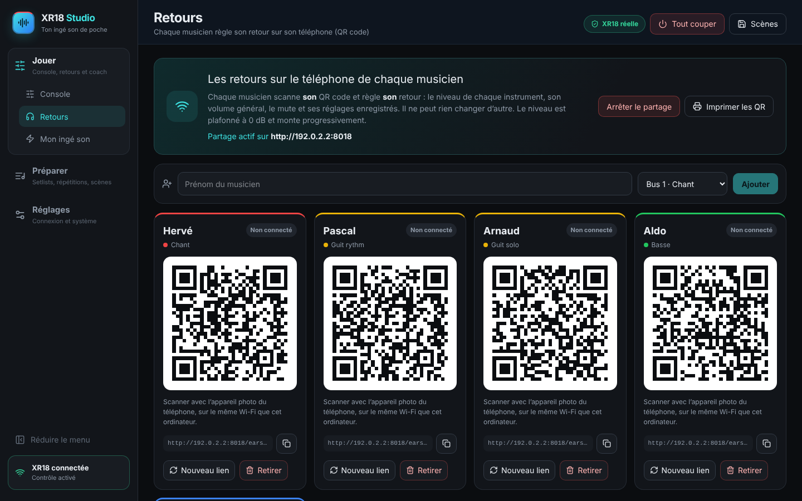

Chaque musicien **scanne son QR code** avec l’appareil photo de son téléphone, sur le même Wi-Fi. Il n’a aucune application à installer.

Sur son téléphone, il règle **uniquement son retour** :
- le volume général et **Couper** ;
- le niveau de chaque instrument ;
- ses réglages enregistrés (« Concert », « Répète »…).

Il ne peut rien changer d’autre. Le volume est plafonné à 0 dB et monte par petits pas, pour protéger les oreilles.

> ℹ️ Le retour est **pré-fader** : ce que tu changes pour le public ne bouge pas les oreilles des musiciens. Démarre le boîtier in-ear **volume bas**.

---

## Étape 6 : Garder le bon réglage

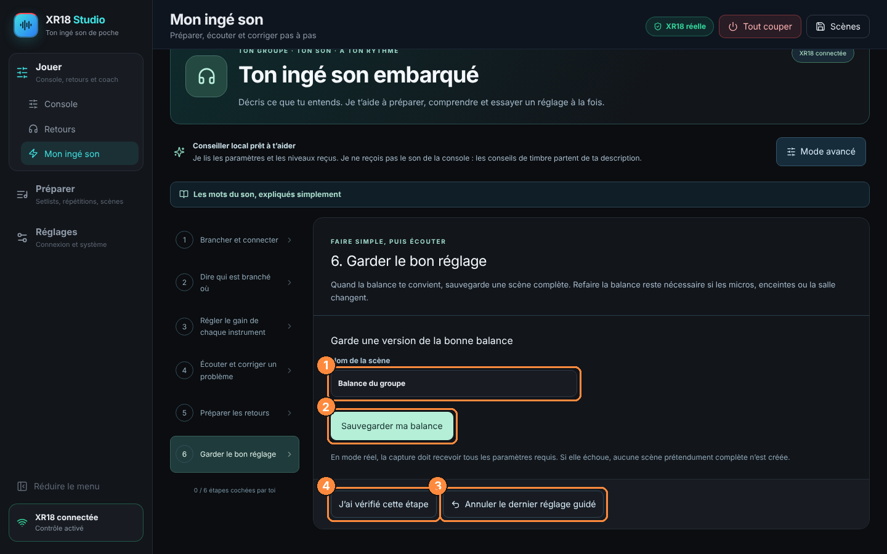

1. **Nom de la scène**, par exemple « Répète du jeudi » ou « Concert salle des fêtes ».
2. **Sauvegarder ma balance** : toute la console est enregistrée. Tu la retrouves dans **Préparer › Scènes**.
3. **Annuler le dernier réglage guidé** : à tout moment, pour revenir en arrière.
4. **J’ai vérifié cette étape** coche l’étape dans le parcours.

> Nouvelle salle, autres micros, autres enceintes ? Refais au moins l’**étape 3** (les gains).

---

## Si quelque chose ne va pas

| Problème | Que faire |
|---|---|
| La console n’est pas trouvée | Même réseau pour l’ordinateur et la XR18. Sur Mac, autorise le **Réseau local** (voir l’étape 1). |
| « Pas de signal » à la mesure | Vérifie le câble, le numéro de prise, le volume de l’instrument, et le 48 V d’un micro statique (à activer toi-même dans la console). |
| « Ça sature » | Le coach propose de baisser le gain. Si l’instrument lui-même distord (pédale, DI), corrige-le à la source. |
| « Gain en butée » | Le préampli est déjà au maximum ou au minimum : règle la sortie de l’instrument ou la position du micro. |
| Le gate coupe des notes douces | Refais **Mesurer la repisse**, ou rapproche le micro du fût. |
| Ça siffle | Baisse le volume concerné ou **Tout couper**. Éloigne le micro des enceintes. |
| Un réglage ne te plaît pas | **Annuler le dernier réglage guidé**. |
| Un musicien n’arrive pas sur sa page | Même Wi-Fi que l’ordinateur. Sinon, crée-lui un **Nouveau lien** dans **Retours**. |

## Les mots du son

| Mot | En clair |
|---|---|
| **Gain** | Le réglage d’entrée du micro (préampli). Tout en dépend. |
| **Niveau max** | Le moment le plus fort mesuré. On vise −6 dB. |
| **Coupe-bas** | Retire les graves inutiles (grondements, vibrations). |
| **Égaliseur (EQ)** | Monte ou baisse le grave, le médium, l’aigu. |
| **Compresseur** | Rapproche les passages forts et faibles. |
| **Gate** | Coupe le micro quand son instrument ne joue pas. |
| **Repisse** | Le son des autres instruments capté par un micro. |
| **Pan** | Place le son à gauche ou à droite. |
| **Façade** | Le son pour le public. |
| **Retour / bus** | Le mix envoyé aux oreilles d’un musicien (sortie Aux). |
| **Pré-fader** | Le retour ne suit pas les volumes de la façade. |
| **48 V** | Alimentation des micros statiques. Le coach n’y touche jamais. |

---

Pour aller plus loin : le [guide complet](USER_GUIDE_FR.md) (console Simple et Expert, scènes, setlists) et le [détail technique du coach](INGE_SON.md) (valeurs de chaque instrument, règles de calcul).
