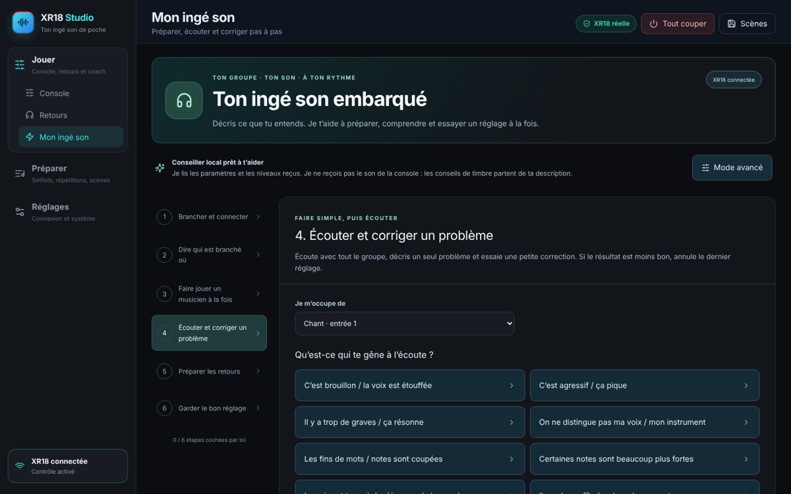

# XR18 Studio 1.3 — Step-by-step tutorial

[Français](USER_GUIDE_FR.md) · [Console guide (every option, French)](GUIDE_CONSOLE.md) · [Downloads](https://github.com/herve8940/xr18-studio-/releases/latest) · [Home](../README.md)

XR18 Studio controls a Behringer **XR18** (also X18 and MR18) from a computer, a tablet, and each musician’s phone for their own monitor mix. This tutorial follows a real day: install, connect, soundcheck, mix, give musicians their monitors, prepare the show. The interface is in French; this guide translates the labels.

> Screenshots were taken with an emulated mixer: channel names (Chant, Guitare 1…) are examples. On your XR18 the app shows the names and colours stored in the mixer.

**Contents**

1. [What you need](#1-what-you-need)
2. [Install](#2-install)
3. [First launch, no mixer](#3-first-launch-no-mixer)
4. [Connect the XR18](#4-connect-the-xr18)
5. [Finding your way: three spaces](#5-finding-your-way-three-spaces)
6. [Soundcheck with “Mon ingé son”](#6-soundcheck-with-mon-ingé-son)
7. [Front-of-house in Simple mode](#7-front-of-house-in-simple-mode)
8. [Detailed settings in Expert mode](#8-detailed-settings-in-expert-mode)
9. [Monitors on each musician’s phone](#9-monitors-on-each-musicians-phone)
10. [Prepare: setlists, rehearsals, scenes](#10-prepare-setlists-rehearsals-scenes)
11. [Show day checklist](#11-show-day-checklist)
12. [Troubleshooting](#12-troubleshooting)
13. [Backups, updates and limits](#13-backups-updates-and-limits)

---

## 1. What you need

- An **XR18**, X18 or MR18 (original or V2).
- A **Windows**, **Mac** (Intel or Apple Silicon) or **Linux** computer.
- **A Wi-Fi router** for the band or venue. The computer, the mixer (wired is best) and the musicians’ phones must all be on that same network. The XR18’s built-in Wi-Fi is fine for the computer alone but too limited for several phones.
- For phone monitors: any recent smartphone with a camera, to scan the QR code. No app to install.

## 2. Install

Download the file for your computer from the [releases page](https://github.com/herve8940/xr18-studio-/releases/latest). Nothing else is needed: the engine and interface are included.

| Computer | File | Install |
|---|---|---|
| Windows | `XR18-Studio-Windows-1.3.0.exe` | Double-click. Installs for your account and creates a shortcut. |
| Intel Mac | `XR18-Studio-macOS-1.3.0-x64.dmg` | Open it and drag XR18 Studio to Applications. |
| Apple Silicon Mac (M1, M2, M3…) | `XR18-Studio-macOS-1.3.0-arm64.dmg` | Same. |
| Ubuntu / Debian | `.deb` file | Open it in the software installer. |
| Other Linux | `.AppImage` file | Allow execution in its properties, then open it. |

Packages are not signed with a commercial certificate:

- **Mac**: the first time, **right-click › Open** and confirm, or use System Settings › Privacy & Security › “Open Anyway”.
- **Windows**: if SmartScreen appears, click **More info › Run anyway**.

Never disable your system’s protections globally. A managed computer may need its administrator.

## 3. First launch, no mixer

On first launch the app runs in **simulation**: you can explore everything without touching your mixer. The orange **Simulation** badge at the top right reminds you.

In simulation, nothing is sent to a mixer and meters do not move. It is ideal for learning, preparing setlists or showing the app to the band.

## 4. Connect the XR18

1. Power the mixer and plug it into the router, or join the XR18’s own Wi-Fi from the computer.
2. Open **Réglages** (Settings), at the bottom of the left menu or via the connection card at the bottom left.
3. Click **Détecter et connecter ma XR18** (Detect and connect my XR18). With one mixer, it connects immediately; with several, pick yours.
4. The connection starts **read-only**: nothing changes on the mixer. When ready, click **Activer le contrôle** (Enable control) and confirm.

**On a Mac**, the first attempt makes macOS ask whether XR18 Studio may find devices on the local network: click **Allow**. Without it, the mixer is unreachable.

The connection is remembered for next time. If detection fails, open **Connexion manuelle** (manual connection) and type the mixer’s IP: `192.168.1.1` on the XR18’s own Wi-Fi, otherwise the address given by your router.

**Synchronising after connecting.** The same page offers a direction:

- **Table → PC** (Mixer → PC, recommended): reads the mixer’s current settings. Nothing is sent.
- **PC → Table** (PC → Mixer): sends a copy saved on the computer. A preview shows every difference first. Phantom power is excluded by default and needs a separate confirmation.

Do not operate the mixer from another app (X-AIR Edit, tablet…) during these operations.

## 5. Finding your way: three spaces

The app has **three spaces**: in the left menu on a computer, as icons on a tablet, at the bottom on a phone.

| Space | Pages | When |
|---|---|---|
| **Jouer** (Play) | Console, Retours (monitors), Mon ingé son (coach) | Soundcheck, rehearsal, show |
| **Préparer** (Prepare) | Setlists, Répétitions (rehearsals), Scènes (scenes) | Before: repertoire, goals, saved settings |
| **Réglages** (Settings) | Connexion & système | Find the mixer, enable control, accounts |

At the top of every page:

- the mixer status: **XR18 réelle** (green), **Simulation** (orange) or **Déconnectée** (red);
- **Tout couper** (red): mutes all 16 inputs at once, for feedback or emergencies;
- **Scènes**: save or recall settings.

The connection card at the bottom left shows whether control is enabled.

| Tablet | Phone |
|---|---|
|  |  |

## 6. Soundcheck with “Mon ingé son”

**Jouer › Mon ingé son** (“My sound engineer”) guides bands without an engineer in six steps:

1. Plug in and connect.
2. Say who is plugged in where.
3. Play one musician at a time.
4. Listen and fix one problem.
5. Prepare monitors.
6. Keep the good setting.

In step 4, choose the instrument and what bothers you (“the voice is muffled”, “it squeals”…), or describe it in your own words. The adviser suggests a small correction you preview, try and can undo with **Annuler le dernier réglage guidé** (undo last guided change).

The adviser receives mixer settings and levels, **not the audio**: its advice comes from your description. With feedback, lower the level at once (or **Tout couper**) before looking for the cause. The optional OpenAI dialogue is not required; the local adviser needs no subscription. See [Mon ingé son](INGE_SON.md).

## 7. Front-of-house in Simple mode

**Jouer › Console**, **Simple** switch at the top. This is the show mode: large touch-friendly strips, one per source.

For each source, top to bottom:

- **name and colour** (from your mixer): tap to open that source’s detailed settings;
- **level in dB** (0 dB nominal, −∞ off);
- **fader and meter**: drag to adjust; keep the meter in green/yellow, red at the top means clipping;
- **Mute** (turns red, “Coupé”) and **Solo** (headphones only, the audience hears no change).

The right-hand strip is the **main volume**.

**Setting a musician’s monitor.** At the top, choose their monitor (e.g. “Retour Gtr”) instead of **Façade** (front of house): the faders now control what that musician hears; the audience is unaffected. Levels turn cyan as a reminder.

Unnamed inputs are hidden; **Afficher aussi les entrées sans nom** shows them.

**Gestures everywhere**:

- **drag** to adjust, hold **Shift** for fine control;
- **mouse wheel** for small steps;
- **double-click** to return to 0 dB.

Every move goes to the mixer immediately, then the stored value is read back.

## 8. Detailed settings in Expert mode

The **Expert** switch shows the whole mixer, organised like X-AIR Edit.

- **Tabs at the top**: Mixer, Canal, Entrée, Gate, EQ, Comp, Envois, Main, Effets, Routage, Vumètres.
- **In the middle, the selected strip** (click a name in the bank to change).
- **At the bottom, the fader bank**.
- **On the right, the mix bar**: front of house, monitors or effects on the faders, DCA, Clr Solo, mute groups, auto mix.

**? Explications** shows, next to each view, what each setting does in plain (French) language. The [console guide](GUIDE_CONSOLE.md) collects these explanations with screenshots and all 61 effects.

**Common tasks**:

- **Mic gain** (Entrée tab): have the musician play loud and raise **Mic Gain** until peaks reach −12 to −6 dB. Gain belongs to the physical input, so it affects every channel using it.
- **Phantom power** (condenser mics): **48V Phantom** in Entrée, always confirmed. Never on a ribbon mic.
- **Low cut** (Entrée or EQ): 80–100 Hz on vocals and guitars removes stage rumble.
- **EQ**: drag a point on the curve; the wheel changes its width. Cut what bothers you before boosting.
- **Compressor and gate**: start from a preset (Kick, Snare, Bass, Vocal…), then set the threshold by ear.

**Always protected**: phantom power, routing and effect changes require confirmation, with preview and automatic backup. Changing the input socket or linking two channels also asks first.

The **Préréglages par instrument** (instrument presets), **Bibliothèque d’effets** (effects library) and **Tous les paramètres** (all parameters) tabs remain above the Expert console.

## 9. Monitors on each musician’s phone

Each musician sets **their own monitor** from their phone, without an app, by scanning **their** QR code.

### On the computer: create the QR codes

1. Go to **Jouer › Retours**.
2. Click **Démarrer le partage** (start sharing). The first time, your system may ask to allow XR18 Studio through the firewall: allow it for private networks.
3. Type the musician’s first name, choose **their monitor** (bus 1–6) and click **Ajouter** (Add). Repeat for each musician.
4. Each musician scans their QR code with the phone camera. **Imprimer les QR** prints a sheet with every code to tape near the monitors.

Each card shows whether that musician’s phone is connected. If a phone is lost or a musician leaves, click **Nouveau lien** (new link): the old QR code stops working immediately. **Retirer** removes access.

### On the phone: the “Mon retour” page

| My monitor | Saved mixes |
|---|---|
|  |  |

- **Volume de mon retour**: the overall monitor volume, and **Couper** to mute it at once.
- **Ce que j’entends** (what I hear): one bar per instrument; slide right to hear it louder. The thin bar below shows the level being played now. Sources not yet sent are hidden; **Tout afficher** shows them.
- **Mes réglages enregistrés** (my saved mixes): type a name (“Concert”, “Acoustic rehearsal”) and **Enregistrer**. **Rappeler** restores the mix smoothly in about a second.
- Touching does nothing on its own: only **sliding** changes a level, so playing never moves it by accident.

**What musicians cannot do**: touch the front-of-house mix, other musicians’ monitors, gain, phantom power, effects or routing. Their link only reaches their own monitor.

**Hearing safety**: from a phone, no level goes above 0 dB, and each move can only raise a level by a small step (lowering is always free). Start low, then raise what is missing, and check the transmitter or monitor amp volume too.

**Good to know**:

- The page is **read-only** until control is enabled in Réglages.
- Sharing stops when the app closes; restart it each time. QR codes stay valid while the computer keeps the same network address (same router); on another network, print them again. Reserving the computer’s address in the router keeps it fixed.
- The connection is not encrypted: use the band’s private, password-protected Wi-Fi, never a public network.
- Adding the page to the phone’s home screen (browser menu › “Add to Home Screen”) reopens it like an app.

## 10. Prepare: setlists, rehearsals, scenes

**Setlists**: add songs to the repertoire (title, artist, tempo), then **+ Setlist** to build the running order. Name it and click **Sauvegarder** (save).

**Répétitions** (rehearsals): write goals for the next rehearsal and save it with its date.

**Scènes** (scenes): a snapshot of every mixer setting (channels, processing, sends, effects…).

- **Sauvegarder la scène complète**: after every good soundcheck.
- **Sauvegarder pour ReaCue (sans 48 V)**: for REAPER automation, see [ReaCue](SHOW_CONTROL.md).
- X-AIR Edit `.scn` files can be imported for archiving. To recall one, load it in X-AIR Edit, connect XR18 Studio and capture a complete scene.

The mixer is backed up automatically before every recall.

## 11. Show day checklist

1. Plug in the router, the mixer (network cable) and the computer. Speakers and monitors **at minimum**.
2. Launch XR18 Studio, check the **XR18 réelle** badge, then **Réglages › Activer le contrôle**.
3. **Scènes**: recall the band’s scene (or **Table → PC** if the mixer is already set).
4. **Jouer › Retours › Démarrer le partage**. Musicians open their QR codes and check that their page shows “En direct” (live).
5. Soundcheck: one musician at a time (**Mon ingé son**, step 3), then the whole band.
6. During the show: **Simple** mode on front of house. **Tout couper** stays at the top for emergencies.
7. After the show: **Scènes › Sauvegarder la scène complète** if anything changed.

## 12. Troubleshooting

| Problem | Fix |
|---|---|
| “XR18 déconnectée” | Check power and network cable, and that the computer is on the same network. Try manual connection with the mixer’s IP. |
| “Réseau injoignable” or `EHOSTUNREACH` (Mac) | macOS is blocking local network access: **System Settings › Privacy & Security › Local Network**, enable **XR18 Studio**, then quit and relaunch. If the mixer’s address changed, click **Détecter et connecter ma XR18**. |
| Detection finds nothing | The firewall may block XR18 Studio: allow it on private networks. Guest networks and VLANs block discovery. |
| Faders do not move the mixer | Control is off (bottom-left card says “Lecture seule”): **Réglages › Activer le contrôle**. |
| QR code opens nothing | The phone must be on the **same Wi-Fi** as the computer (not mobile data), and sharing must be started. |
| Phone shows “Lien expiré” | The link was regenerated or removed: scan the new QR code. |
| Phone shows “Reconnexion…” | The computer slept, the app closed or Wi-Fi dropped. The page reconnects by itself. |
| Musician cannot go louder | The 0 dB ceiling is reached: raise the transmitter/amp volume or lower other sources. |
| “Une opération est en cours” | A save, scene recall or sync is running on the computer: wait a few seconds. |
| Sound changes by itself | Another app (X-AIR Edit, tablet) or ReaCue is also controlling the mixer. |

To report a problem: **Réglages › Télécharger le journal de diagnostic** (download diagnostic log), then attach it with your OS, version and steps to reproduce. The log contains no API key or password.

## 13. Backups, updates and limits

- **Backups**: export important scenes and copy the app’s data folder before updating.
- **Updates**: download the new installer from [GitHub releases](https://github.com/herve8940/xr18-studio-/releases/latest), close XR18 Studio, then install. There is no automatic updater.
- **Limits**:
  - the app receives settings and levels, **not audio**;
  - solo and meter rate still need validation on a physical mixer;
  - software tests and the emulator do not replace a real soundcheck before a show;
  - hearing safety does not replace careful monitor levels.
- **Advanced multi-device access**: opening the full console from a tablet needs HTTPS server mode with accounts, see [advanced features](FONCTIONS_0_2.md). For monitors, QR codes are enough.
