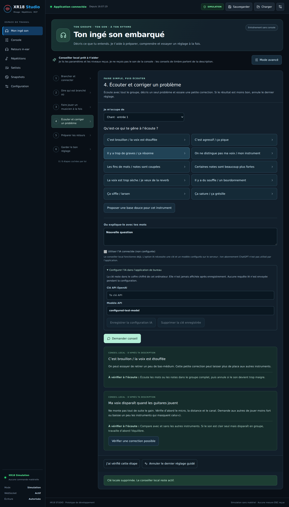

# XR18 Studio 1.0 — User guide

[Français](USER_GUIDE_FR.md) · [Downloads](https://github.com/herve8940/xr18-studio-/releases/latest) · [Home](../README.md)

## Install and launch

The desktop package includes the backend and interface. No Node.js, terminal or separate server installation is required.

| Computer | Download | Installation |
|---|---|---|
| Windows x64 | `XR18-Studio-Windows-1.0.0.exe` | Double-click. Installs for your user account and creates shortcuts. |
| Intel Mac | `XR18-Studio-macOS-1.0.0-x64.dmg` | Open, then drag XR18 Studio into Applications. |
| Apple Silicon Mac | `XR18-Studio-macOS-1.0.0-arm64.dmg` | Open, then drag XR18 Studio into Applications. |
| Ubuntu/Debian x64 | `.deb` package | Open in your distribution’s software installer. |
| Other Linux x64 | `.AppImage` file | Allow execution in file properties, then open it. |

Packages are not signed/notarized using a commercial certificate. Windows or macOS may request additional approval or block launch depending on policy. Check the download source and the published SHA-256 checksums. Do not disable system protection globally. On a personal Mac, use the per-app approval in System Settings > Privacy & Security if available. Managed computers may require their administrator.

Targets are recent Windows x64, Intel/Apple Silicon macOS and Linux x64 systems. Old iPads are not guaranteed supported and cannot run the desktop installer. Tablet access requires the HTTPS server mode and accounts; see [multi-device features](FONCTIONS_0_2.md). The current interface uses French labels; this guide explains them in English.

## 1. Explore without a console

The first launch opens **Mon ingé son** (My sound engineer) in simulation mode. Explore without changing the XR18. Simulated fader positions are not audio measurements. Channel names in the screenshot are examples.

Each strip represents an input; Main L/R is the main output. The fader adjusts mix level and M mutes the channel. Tabs provide controls, EQ, dynamics, sends, effects, routing and DCA. Use detailed parameters and change previews as the reference; the small illustrative EQ curve in the Mixage page is not a console measurement.

## 2. Connect your XR18

1. Power on the console and connect the computer to the same local network.
2. Open **Configuration**, then **Détecter et connecter ma XR18** (Detect and connect my XR18). This is also available in the desktop Connexion menu.
3. One console connects read-only; if several appear, select the intended console.
4. Check channel names and connection status. Select **Activer le contrôle** (Enable control) and confirm when ready to operate the mixer.

No restart or technical configuration file is required. Connection settings are remembered. If discovery fails, check the firewall and shared network; guest networks and VLANs may block discovery. Manual IP entry is available as a fallback. [Technical details](CONNEXION_XR18.md).

## 3. Prepare your band

Follow six steps: connect, assign instruments, have each musician play, address a sound issue, prepare monitors, save. The suggested band is vocals, two guitars, bass and TD-27 left/right. Change the input numbers to match your actual wiring. Instruments are not identified automatically and stereo links are not created automatically.

**Préparer une base douce** (Prepare a gentle starting point) previews channel names, colors and mild processing. Review before confirming. This preparation does not change input gain, phantom power, faders or routing. Checked steps are your confirmations, not automatic certification.

## 4. Check and improve the sound

Have one musician play and select **Vérifier le signal** (Check signal). Approximately five seconds of fresh OSC measurements are needed. No levels are invented without real console data. This does not measure ear-level sound pressure, spectrum or acoustic quality.

Choose an instrument and an issue such as muffled vocals or excessive bass, or describe it in your own words. The local adviser offers checks and, where appropriate, a small correction for review. Confirm to try it. **Annuler le dernier réglage guidé** (Undo the last guided adjustment) prepares a preview of the backed-up settings. Listen after each change.

The adviser receives OSC parameters and levels, **not audio**. Tonal suggestions are hypotheses based on your description. For feedback or excessive levels, reduce the relevant level immediately and check microphone/speaker placement; do not wait for automatic analysis.

## 5. Monitors, effects and scenes

- **Retours in-ear** (In-ear monitors): select the musician’s bus and change sends gradually. Start low and check receiver volume. A numerical ceiling does not guarantee hearing protection.
- **Effets / Contrôles**: read parameters, preview changes, then confirm. Keep a backup before major changes.
- **Scenes**: capture a complete Studio JSON version 2 scene in the server library. These are different from browser-local quick fader snapshots.
- **Existing `.scn` files** can be imported, archived and exported. Recall is blocked before writes when opaque textual FX parameters cannot be interpreted. Conversion path: load the `.scn` onto the console using X Air Edit, connect Studio, then capture a complete JSON v2 scene. Universal `.scn` recall is not guaranteed.

## 6. Optional AI, ReaCue and musician access

The local adviser needs no subscription or API key. For optional OpenAI dialogue, open desktop AI configuration and enter your API key and a model supporting Responses and structured outputs. Credentials are encrypted using the operating system’s secure storage; saving may be refused where secure storage is unavailable. Never put a key in GitHub. API usage is billed separately from ChatGPT.

External requests require consent. Only the question, instrument type and connection state are sent, without audio or scenes. AI responses are advisory and never directly command the mixer. [Details](INGE_SON.md).

For REAPER/ReaCue, install the Lua action and bridge in `integrations/` and follow [SHOW_CONTROL](SHOW_CONTROL.md). Accounts and bus permissions support musician access. Network access requires HTTPS and configured accounts; see [FONCTIONS_0_2](FONCTIONS_0_2.md). The desktop package starts locally and does not automatically expose an iPad server.

## Backups, updates and support

Export important scenes and copy the application data folder before upgrading. Desktop SQLite and connection settings are kept in the system user-data folder; local snapshots depend on the browser. An upgrade does not replace a backup.

Download the next installer from GitHub Releases and close Studio before installing. There is no silent automatic updater. Bug reports should include OS, version, real/simulation mode and reproduction steps, without API keys or passwords.

## Version 1.0 validation

Automatic publication requires tests, builds, all four platform packages and packaged application startup checks. Software tests and the OSC emulator do not replace testing with a physical XR18, real monitors and REAPER. Concert qualification and universal old-device compatibility are not claimed. Release notes state the available validation results.

## Two-way synchronization (1.1)

After connecting, Configuration displays **Sens de synchronisation** with **Table → PC** selected and a **Synchroniser** button. Return here whenever needed.

- **Table → PC**: re-read the console’s known catalog and retain a new independent PC snapshot. Use after editing in X Air. No settings are sent.
- **PC → Table**: enable control, choose a PC snapshot or complete scene, then select Synchronize to review differences. Explicitly confirm to send. Phantom power is excluded by default and requires separate inclusion and application confirmations.

Simulation preparations are saved before connection. PC snapshots stay separate from live values. Unconfigured simulation values are defaults; review before sending. The mixer is backed up before writes, and changes since preview cause rejection. Do not operate other applications during synchronization: OSC cannot lock other clients. Failures can leave partial changes; backups remain in scenes. Capture fails when a required catalog parameter is unavailable.

## Input gain controls (1.2)

In Console > Mixage, select **Entrée / Gain**, then **Lire l’entrée**. Studio identifies the mapped analog input or offers USB trim for a USB return. Input gain adapts the received signal; the fader sets its level in the mix. Analog gain also affects other channels using the same physical input, monitors and processing.

Enter gain in dB, preview and confirm. The panel also exposes high-pass filtering and polarity inversion. Phantom power requires an additional confirmation; check connected equipment first. Shortcuts open EQ, dynamics and sends. Values reflect the last explicit read; refresh after changes in another application. Source routing is re-read before applying to detect changed assignments.
