# XR18 Studio 1.3 — Tutoriel pas à pas

[English](USER_GUIDE_EN.md) · [Guide de la console (chaque option)](GUIDE_CONSOLE.md) · [Téléchargements](https://github.com/herve8940/xr18-studio-/releases/latest) · [Accueil](../README.md)

XR18 Studio pilote une table Behringer **XR18** (ainsi que X18 et MR18) depuis un ordinateur, une tablette, et le téléphone de chaque musicien pour son retour. Ce tutoriel suit l’ordre d’une vraie journée : installer, connecter, faire la balance, mixer, donner les retours aux musiciens, préparer le concert.

> Les captures ont été faites avec une table émulée : les noms de canaux (Chant, Guitare 1…) sont des exemples. Chez toi, l’application affiche les noms et couleurs enregistrés dans ta XR18.

**Sommaire**

1. [Ce qu’il te faut](#1-ce-quil-te-faut)
2. [Installer l’application](#2-installer-lapplication)
3. [Premier lancement, sans table](#3-premier-lancement-sans-table)
4. [Connecter la XR18](#4-connecter-la-xr18)
5. [Se repérer : trois espaces](#5-se-repérer--trois-espaces)
6. [Faire la balance avec « Mon ingé son »](#6-faire-la-balance-avec--mon-ingé-son-)
7. [Mixer la façade en mode Simple](#7-mixer-la-façade-en-mode-simple)
8. [Régler en détail en mode Expert](#8-régler-en-détail-en-mode-expert)
9. [Les retours sur le téléphone de chaque musicien](#9-les-retours-sur-le-téléphone-de-chaque-musicien)
10. [Préparer : setlists, répétitions, scènes](#10-préparer--setlists-répétitions-scènes)
11. [Le jour du concert : check-list](#11-le-jour-du-concert--check-list)
12. [Dépannage](#12-dépannage)
13. [Sauvegarde, mises à jour et limites](#13-sauvegarde-mises-à-jour-et-limites)

---

## 1. Ce qu’il te faut

- Une table **XR18**, X18 ou MR18 (version d’origine ou V2).
- Un ordinateur **Windows**, **Mac** (Intel ou Apple Silicon) ou **Linux**.
- **Un routeur Wi-Fi** pour le groupe ou la salle : l’ordinateur, la table (câble réseau conseillé) et les téléphones des musiciens doivent être sur ce même réseau. Le Wi-Fi intégré de la XR18 marche pour l’ordinateur seul, mais il est trop limité pour plusieurs téléphones.
- Pour les retours sur téléphone : n’importe quel smartphone récent avec un appareil photo (pour scanner le QR code). Aucune application à installer.

## 2. Installer l’application

Télécharge le fichier qui correspond à ton ordinateur sur la [page des versions](https://github.com/herve8940/xr18-studio-/releases/latest). Rien d’autre à installer : le moteur et l’interface sont inclus.

| Ordinateur | Fichier | Installation |
|---|---|---|
| Windows | `XR18-Studio-Windows-1.3.0.exe` | Double-clic. L’installation se fait pour ton compte et crée un raccourci. |
| Mac Intel | `XR18-Studio-macOS-1.3.0-x64.dmg` | Ouvre-le et glisse XR18 Studio dans Applications. |
| Mac Apple Silicon (M1, M2, M3…) | `XR18-Studio-macOS-1.3.0-arm64.dmg` | Idem. |
| Ubuntu / Debian | fichier `.deb` | Ouvre-le avec l’installateur de logiciels. |
| Autre Linux | fichier `.AppImage` | Autorise l’exécution dans ses propriétés, puis ouvre-le. |

Les paquets ne sont pas signés par un certificat commercial :

- **Mac** : la première fois, fais **clic droit › Ouvrir**, puis confirme. Ou va dans Réglages Système › Confidentialité et sécurité › « Ouvrir quand même ».
- **Windows** : si SmartScreen s’affiche, clique **Informations complémentaires › Exécuter quand même**.

Ne désactive jamais toutes les protections du système. Un ordinateur d’entreprise ou d’école peut demander l’intervention de son administrateur.

## 3. Premier lancement, sans table

Au premier démarrage, l’application est en **simulation** : tu peux tout découvrir sans toucher à ta table. Le badge orange **Simulation** en haut à droite le rappelle.

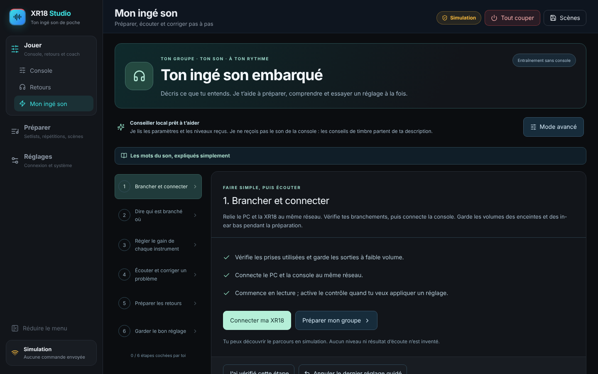

En simulation, aucune commande ne part vers une console et les vumètres ne bougent pas. C’est parfait pour apprendre, préparer les setlists ou montrer l’application au groupe.

## 4. Connecter la XR18

1. Allume la table et branche-la au routeur (ou connecte l’ordinateur au Wi-Fi de la XR18).
2. Va dans **Réglages** (en bas du menu de gauche, ou la carte de connexion en bas à gauche).
3. Clique **Détecter et connecter ma XR18**. Si une seule table est trouvée, la connexion est immédiate. S’il y en a plusieurs, choisis la bonne.
4. La connexion commence en **lecture seule** : rien ne change sur la table. Quand tu es prêt à agir, clique **Activer le contrôle** et confirme.

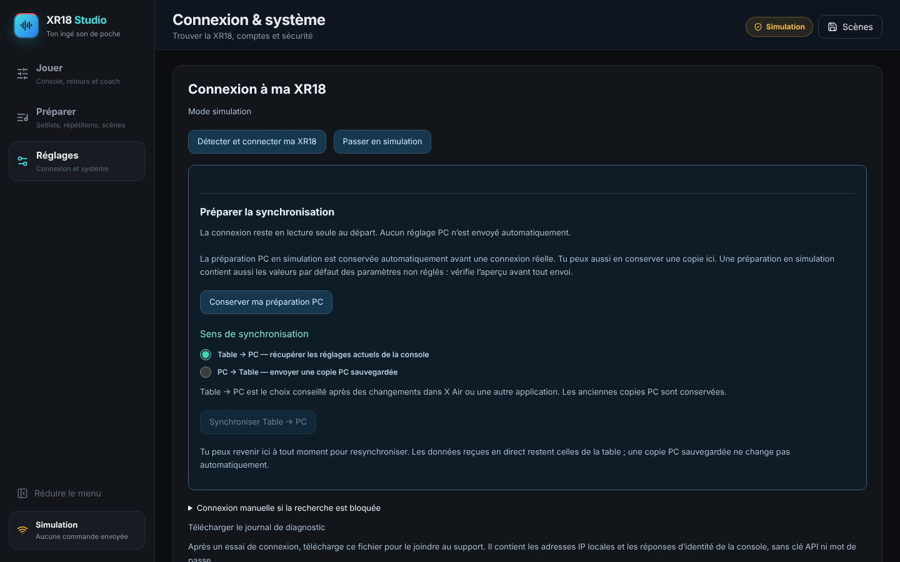

**Sur Mac**, au premier essai, macOS demande d’autoriser XR18 Studio à accéder aux appareils du réseau local : clique **Autoriser**. Sans cette autorisation, la table est injoignable.

La connexion est mémorisée pour le prochain lancement. Si la détection échoue, ouvre **Connexion manuelle** et tape l’adresse IP de la table : `192.168.1.1` si l’ordinateur est sur le Wi-Fi propre de la XR18, sinon l’adresse donnée par ton routeur.

**Synchronisation après connexion.** Le même écran propose le sens de synchronisation :

- **Table → PC** (conseillé) : récupère les réglages actuels de la table. Rien n’est envoyé.
- **PC → Table** : renvoie vers la table une copie sauvegardée sur l’ordinateur. Un aperçu montre chaque différence avant l’envoi. Le 48 V est exclu par défaut et demande un accord séparé.

Pendant ces opérations, ne touche pas la table depuis une autre application (X-AIR Edit, tablette…).

## 5. Se repérer : trois espaces

L’application est rangée en **trois espaces**, dans le menu de gauche sur ordinateur, en icônes sur tablette, et en bas de l’écran sur téléphone.

| Espace | Pages | Quand |
|---|---|---|
| **Jouer** | Console, Retours, Mon ingé son | Balance, répétition, concert |
| **Préparer** | Setlists, Répétitions, Scènes | Avant : répertoire, objectifs, sauvegardes |
| **Réglages** | Connexion & système | Trouver la table, activer le contrôle, comptes |

En haut de chaque page :

- l’état de la table : **XR18 réelle** (vert), **Simulation** (orange) ou **Déconnectée** (rouge) ;
- **Tout couper** (rouge) : coupe les 16 entrées d’un coup, en cas de larsen ou d’urgence ;
- **Scènes** : sauvegarder ou rappeler des réglages.

En bas à gauche, la carte de connexion indique si le contrôle est activé.

| Sur tablette | Sur téléphone |
|---|---|
| 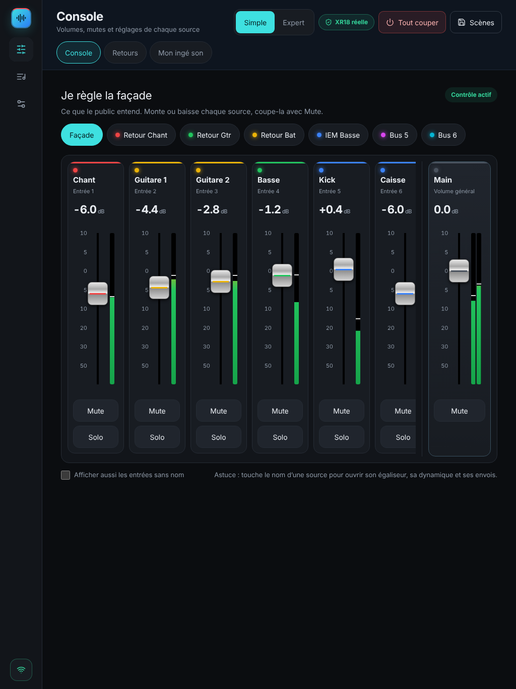 | 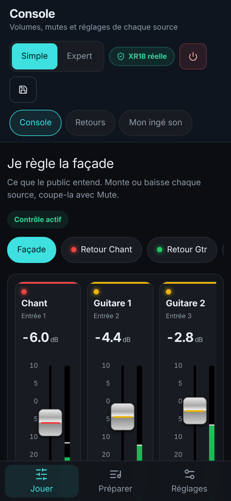 |

## 6. Faire la balance avec « Mon ingé son »

**Jouer › Mon ingé son** est un assistant pour les groupes sans ingé son. Il te guide en six étapes : brancher, dire qui est branché où, régler le gain de chaque instrument, écouter et corriger, préparer les retours, garder le bon réglage.

### Configurer tout le groupe en une fois

À l’étape **2. Dire qui est branché où**, pars d’un modèle : **Rock + batterie électronique**, **Rock + batterie acoustique détaillée** (12 entrées) ou **Acoustique / duo**. Le bouton **Ajouter la batterie détaillée** place kick, snare, tom 1, tom 2, tom 3, OH 1 et OH 2 sur les entrées libres. Les instruments sont rangés par famille : voix, guitares (rythmique, solo, acoustique), basse, batterie détaillée, batterie électronique, claviers.

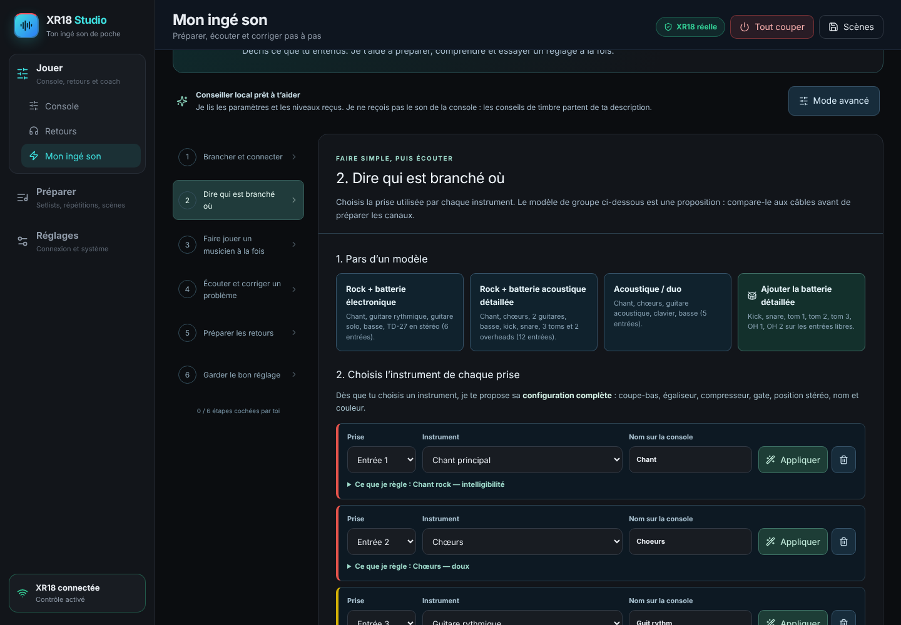

**Dès que tu choisis un instrument, l’assistant te propose sa configuration complète**, selon les bonnes pratiques du live :

- **Coupe-bas** adapté (35 Hz pour le kick, 80 Hz pour le tom aigu, 100 Hz pour le chant…).
- **Égaliseur 4 bandes** avec de vraies corrections, par exemple −4 dB de « carton » à 250 Hz sur le kick et +3 dB d’attaque à 3,5 kHz.
- **Compresseur** réglé : taux, attaque, relâchement et seuil de départ.
- **Gate** sur kick, snare et toms, pour couper la repisse des autres fûts.
- **Position stéréo** : toms répartis, OH 1 à gauche et OH 2 à droite, guitares de part et d’autre.
- **Nom** et **couleur** sur la console.

Ouvre **Ce que je règle** sous chaque instrument pour lire, en clair, ce que fait chaque réglage.

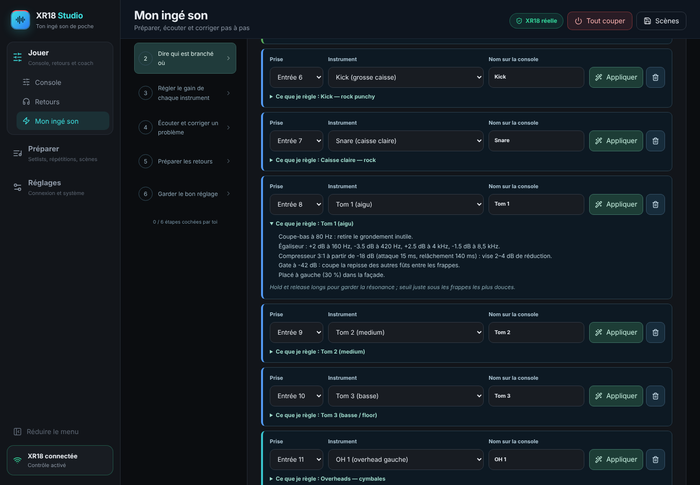

Le bouton **Appliquer** d’une ligne configure cet instrument seul. **Appliquer à tout le groupe** configure tous les instruments d’un coup. Avant d’envoyer quoi que ce soit, l’assistant montre la liste des instruments concernés et le détail « avant / après ». Une sauvegarde est faite à chaque fois, et **Annuler le dernier réglage guidé** remet tout comme avant.

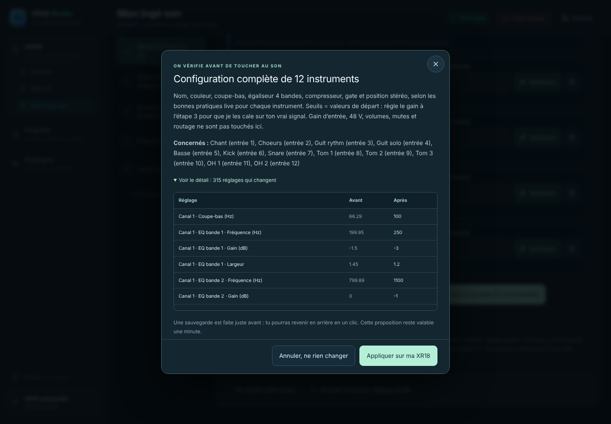

Ce que l’assistant ne touche jamais : le gain d’entrée, le 48 V, les volumes, les mutes et le routage. Les seuils du compresseur et du gate sont d’abord des valeurs de départ ; l’étape 3 (ci-dessous) règle le gain et les recalcule sur ton vrai signal.

Si la console ne confirme pas un réglage, l’assistant continue avec les autres instruments et indique ceux à relancer, au lieu de s’arrêter au premier.

### Régler le gain, puis caler le compresseur et le gate

Tout part du gain. Le compresseur et le gate travaillent sur le signal qui sort du préampli, et leurs seuils sont fixes. Si le gain monte de 6 dB après coup, le compresseur écrase 6 dB de plus et le gate laisse passer la repisse. L’étape **3. Régler le gain de chaque instrument** règle donc ça dans l’ordre, un instrument à la fois.

1. **Régler le gain.** Le musicien joue seul son passage le plus fort pendant 5 secondes. L’assistant mesure la crête et propose le gain pour viser environ −6 dB. Tu vois l’avant / après, tu confirmes, puis tu remesures. Il monte au plus de 6 dB à la fois, ne touche jamais au 48 V et refuse de monter à l’aveugle si rien n’arrive (câble, entrée, 48 V d’un micro statique).
2. **Placer le gate** (kick, snare, toms). L’instrument se tait pendant que les autres jouent fort : l’assistant mesure la repisse et place le gate juste au-dessus. Si la repisse est presque aussi forte que les coups doux, il te conseille de rapprocher ou réorienter le micro.
3. **Appliquer la configuration calée.** Le seuil du compresseur est placé sous la crête mesurée (8 dB pour la voix, 6 dB pour les fûts et les guitares, 4 dB pour les cymbales), le gate selon la repisse.

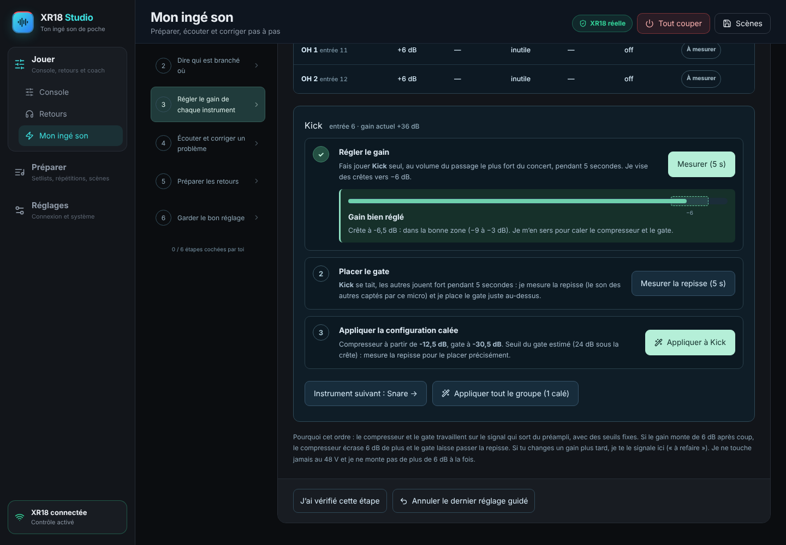

Le tableau en haut montre où en est chaque instrument : gain, crête, repisse, seuils et état (**À mesurer**, **Calé**, **Gain changé : à refaire**). Si quelqu’un touche un gain plus tard, l’instrument repasse en « à refaire » et la configuration complète revient aux seuils de départ, avec un avertissement. **Appliquer tout le groupe** utilise les seuils calés pour chaque instrument mesuré.

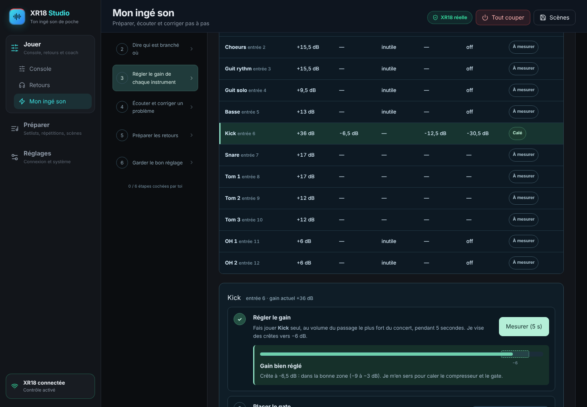

La mesure demande la vraie XR18 et les musiciens qui jouent au volume du concert. En simulation, rien n’est mesuré ni inventé.

### Écouter et corriger

À l’étape 4, choisis l’instrument puis ce qui te gêne (« la voix est étouffée », « ça siffle »…), ou décris-le avec tes mots. L’assistant propose une petite correction que tu prévisualises, essaies et peux annuler. Il reçoit les réglages et les niveaux de la table, **pas le son** : ses conseils partent de ta description. En cas de larsen, baisse tout de suite le volume concerné (ou **Tout couper**).

### Les retours (ears) de chaque musicien

À l’étape **5. Préparer les retours**, clique sur **Proposer les musiciens d’après mon groupe**. L’assistant crée un musicien par instrument principal : chant, chaque guitare, basse, toute la batterie, clavier. Chacun reçoit son bus (sorties Aux 1 à 6). Pour chaque musicien, tu peux changer le nom, le bus, le **rôle** (chanteur·se, guitariste, bassiste, batteur·se, claviériste) et **ses instruments**, qui seront mis devant dans son mix.

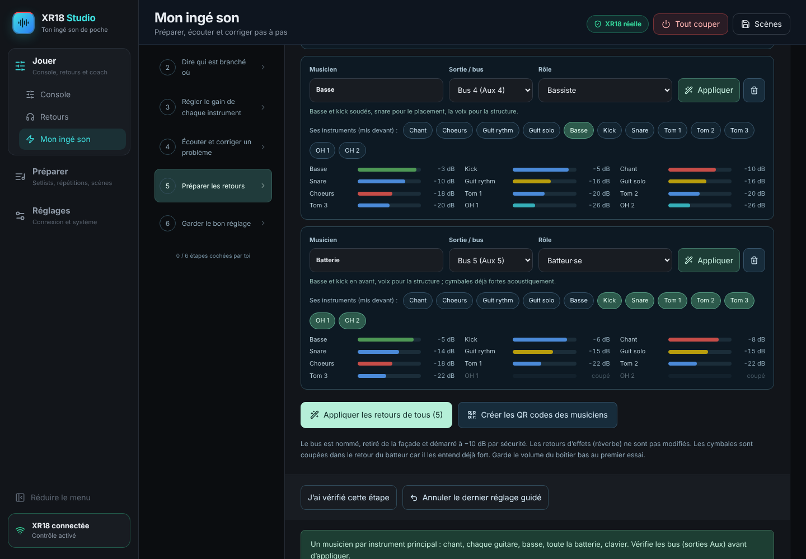

Les barres montrent le mix de départ qui sera envoyé. Il est **pré-fader** : ce que tu changes en façade ne bouge pas les oreilles des musiciens. Exemples de départs :

- **Bassiste** : basse et kick soudés.
- **Chanteur·se** : sa voix devant, avec la section rythmique.
- **Batteur·se** : basse et kick en avant ; les cymbales sont coupées, car il les entend déjà fort.

Le bus est nommé, retiré de la façade et démarré à −10 dB par sécurité. **Appliquer** configure un musicien ; **Appliquer les retours de tous** les configure tous.

Enfin, **Créer les QR codes des musiciens** crée le lien personnel de chacun et ouvre la page **Retours** : chaque musicien scanne son code et affine son mix sur son téléphone (voir la section 9).

Le dialogue avec une IA (OpenAI) est facultatif ; le conseiller local fonctionne sans abonnement. Voir [Mon ingé son](INGE_SON.md).

## 7. Mixer la façade en mode Simple

**Jouer › Console**, bouton **Simple** en haut. C’est le mode du concert : de grosses tranches faciles à toucher, une par source.

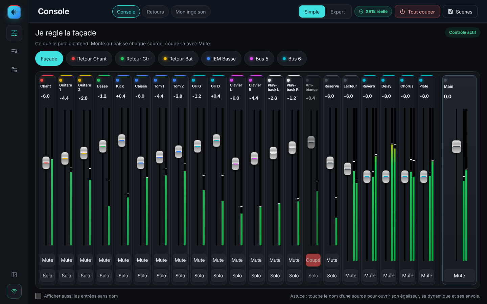

Pour chaque source, de haut en bas :

- **Le nom et sa couleur** (ceux de ta table) : touche-le pour ouvrir le réglage détaillé de cette source.
- **Le niveau en dB** : 0 dB = niveau nominal, −∞ = coupé.
- **Le fader et son vumètre** : glisse pour régler. Le vumètre doit rester dans le vert et le jaune ; le rouge en haut signale une saturation.
- **Mute** (devient rouge « Coupé ») et **Solo** (écoute au casque, sans rien changer pour le public).

La tranche à droite est le **volume général**.

**Régler le retour d’un musicien.** En haut, choisis son retour (par exemple « Retour Gtr ») au lieu de **Façade** : les faders règlent alors ce que ce musicien entend, et le public n’est pas concerné. Les niveaux apparaissent en cyan pour te le rappeler.

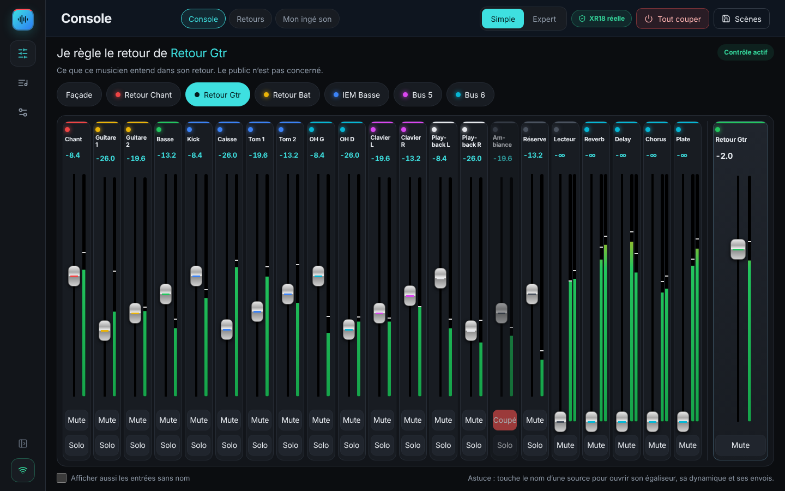

Les entrées sans nom sont masquées pour alléger l’écran ; la case **Afficher aussi les entrées sans nom** les fait réapparaître.

**Gestes utiles partout dans l’application** :

- **glisser** pour régler, **Maj** enfoncée pour un réglage fin ;
- **molette** pour de petits pas ;
- **double-clic** pour revenir à 0 dB.

Chaque geste part tout de suite vers la table, puis l’application relit la valeur vraiment retenue.

## 8. Régler en détail en mode Expert

Bouton **Expert** en haut de la console : toute la table, organisée comme X-AIR Edit.

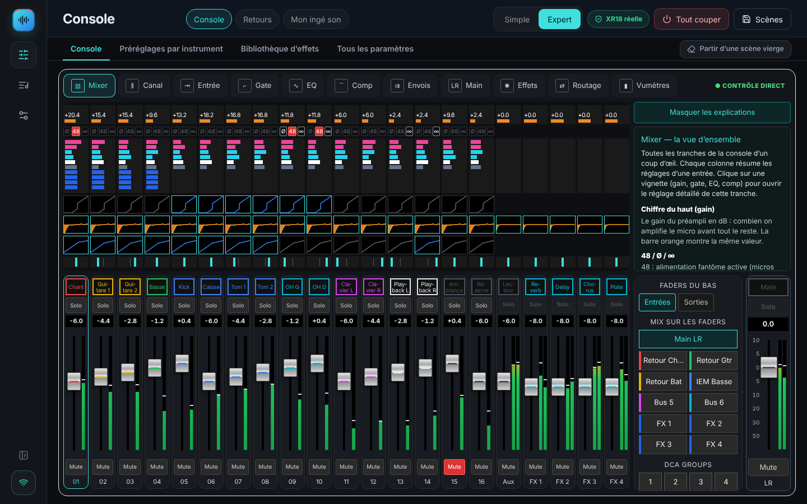

- **En haut, les onglets** : Mixer, Canal, Entrée, Gate, EQ, Comp, Envois, Main, Effets, Routage, Vumètres.
- **Au milieu, la vue de la tranche sélectionnée** (clique sur un nom en bas pour en changer).
- **En bas, la banque de faders**.
- **À droite, la barre de mix** : façade, retours ou effets sur les faders, DCA, Clr Solo, groupes de mute, auto-mix.

Le bouton **? Explications** affiche à côté de chaque vue, en langage simple, à quoi sert chaque réglage. Le [Guide de la console](GUIDE_CONSOLE.md) reprend toutes ces explications avec des captures et la liste des 61 effets.

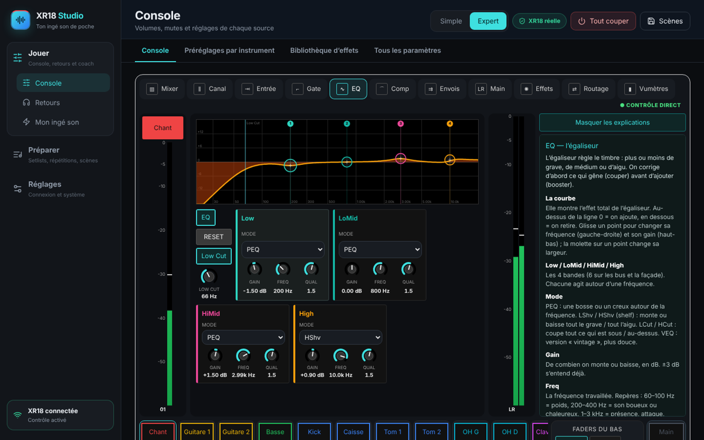

**Quelques réglages courants** :

- **Le gain d’un micro** (onglet **Entrée**) : fais jouer fort, monte le **Mic Gain** jusqu’à ce que le vumètre atteigne −12 à −6 dB. Le gain agit sur la prise physique, donc sur tous les canaux qui l’utilisent.
- **Le 48 V** (micros statiques) : bouton **48V Phantom** dans Entrée, toujours avec confirmation. Ne l’active pas sur un micro à ruban.
- **Le coupe-bas** (Entrée ou EQ) : 80–100 Hz sur les voix et les guitares, pour enlever les bruits de scène.
- **L’égaliseur** : glisse un point de la courbe, la molette change sa largeur. Corrige d’abord ce qui gêne avant d’ajouter.
- **Le compresseur et la gate** : commence par un préréglage (Kick, Snare, Bass, Vocal…), puis ajuste le seuil à l’oreille.

**Toujours protégé** : le 48 V, le routage et le changement d’effet demandent une confirmation, avec aperçu et sauvegarde automatique. Changer la prise d’entrée ou coupler deux canaux pose aussi la question.

Les onglets **Préréglages par instrument**, **Bibliothèque d’effets** et **Tous les paramètres** restent disponibles au-dessus de la console Expert.

## 9. Les retours sur le téléphone de chaque musicien

Chaque musicien règle **son propre retour** depuis son téléphone, sans application, en scannant **son** QR code.

### Côté ordinateur : créer les QR codes

1. Va dans **Jouer › Retours**.
2. Clique **Démarrer le partage**. Au premier démarrage, le système peut demander d’autoriser XR18 Studio dans le pare-feu : accepte pour les réseaux privés.
3. Tape le prénom du musicien, choisis **son retour** (bus 1 à 6), puis **Ajouter**. Recommence pour chaque musicien.
4. Chaque musicien scanne son QR code avec l’appareil photo de son téléphone. **Imprimer les QR** sort une feuille avec tous les codes, à scotcher près des retours.

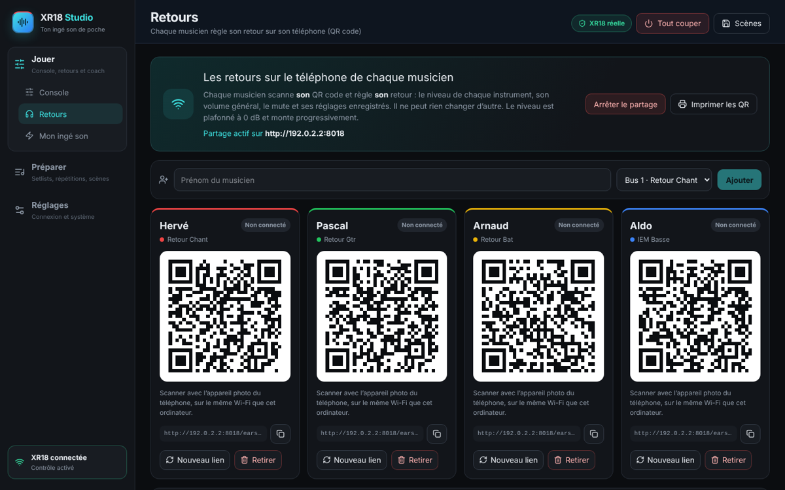

Chaque carte indique si le téléphone du musicien est connecté. Si un téléphone est perdu, ou si un musicien quitte le groupe, clique **Nouveau lien** : l’ancien QR code cesse aussitôt de fonctionner. **Retirer** supprime l’accès.

### Côté musicien : la page « Mon retour »

| Mon retour | Mes réglages enregistrés |
|---|---|
| 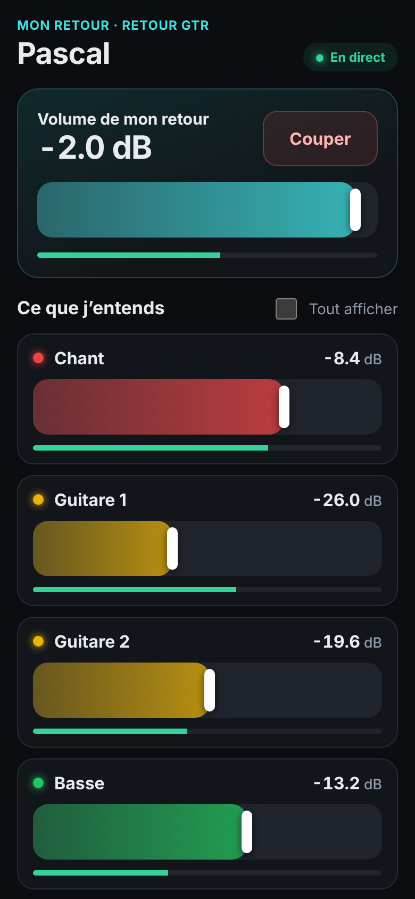 | 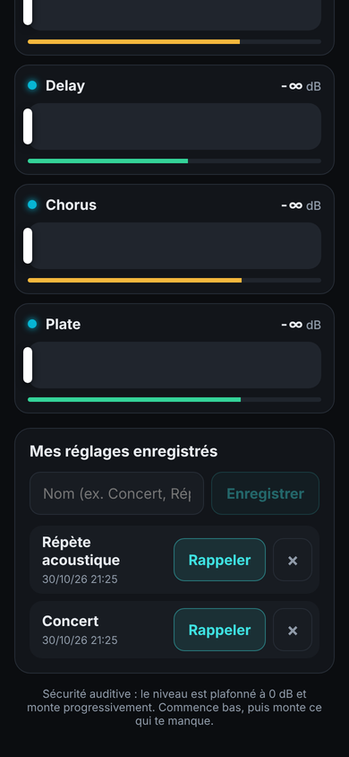 |

- **Volume de mon retour** : le volume général de son retour, et **Couper** pour le couper d’un geste.
- **Ce que j’entends** : une barre par instrument. Glisse vers la droite pour l’entendre plus fort. La fine barre en dessous montre le niveau joué en ce moment. Les sources pas encore envoyées sont masquées ; **Tout afficher** les montre.
- **Mes réglages enregistrés** : donne un nom (« Concert », « Répète acoustique ») et **Enregistrer**. **Rappeler** retrouve ce mix en douceur, en une seconde environ.
- Poser le doigt ne change rien : seul le **glissement** modifie le niveau, pour éviter les accidents en jouant.

**Ce que le musicien ne peut pas faire** : toucher la façade, les retours des autres, le gain, le 48 V, les effets ou le routage. Son lien ne donne accès qu’à son retour.

**Sécurité auditive** : depuis un téléphone, aucun niveau ne dépasse 0 dB, et chaque geste ne peut monter que d’un petit pas (baisser est toujours libre). Commence bas, puis monte ce qui manque. Vérifie aussi le volume de l’émetteur ou de l’ampli des retours.

**Bon à savoir** :

- La page reste en **lecture seule** tant que le contrôle n’est pas activé dans Réglages.
- Le partage s’arrête quand on ferme l’application : il faut le redémarrer à chaque lancement. Les QR codes restent valables tant que l’ordinateur garde la même adresse sur le réseau (même routeur) ; sur un autre réseau, réimprime-les. Pour une adresse fixe, réserve-la pour l’ordinateur dans les réglages du routeur.
- La connexion n’est pas chiffrée : utilise le Wi-Fi privé du groupe, protégé par mot de passe, jamais un réseau public.
- Ajouter la page à l’écran d’accueil du téléphone (menu du navigateur › « Sur l’écran d’accueil ») permet de la rouvrir comme une application.

## 10. Préparer : setlists, répétitions, scènes

**Setlists** : ajoute les morceaux au répertoire (titre, artiste, tempo), puis **+ Setlist** pour construire l’ordre de passage. Donne un nom à la setlist et **Sauvegarder** pour la garder.

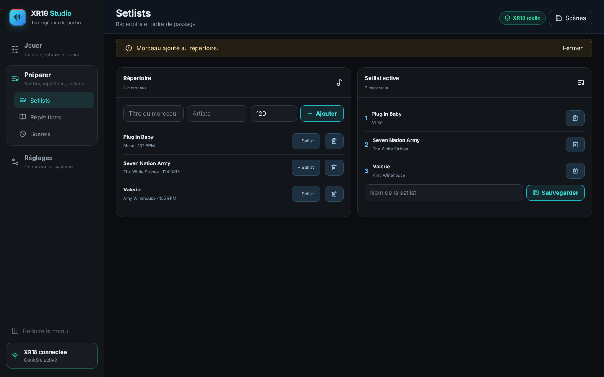

**Répétitions** : note les objectifs de la prochaine répétition (morceaux à travailler, réglages à revoir) et enregistre-la avec sa date.

**Scènes** : une scène est une photo de tous les réglages de la table (canaux, traitements, envois, effets…).

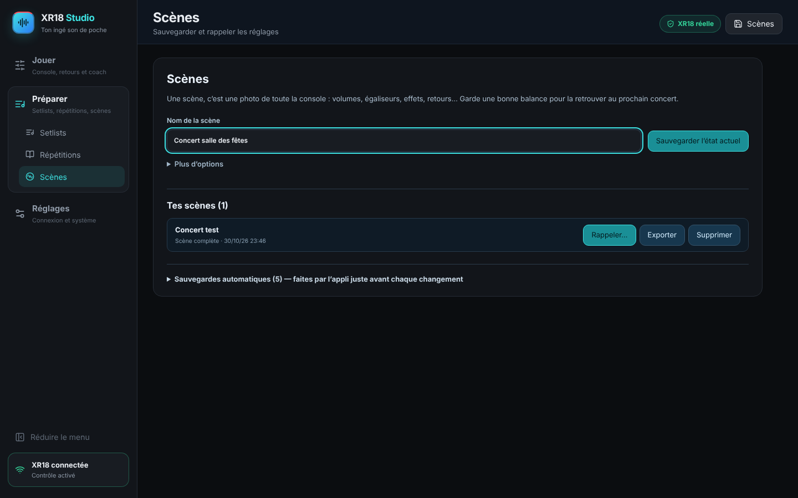

- **Sauvegarder la scène complète** : à faire après chaque balance réussie.
- **Sauvegarder pour ReaCue (sans 48 V)** : version utilisable par l’automatisation REAPER, voir [ReaCue](SHOW_CONTROL.md).
- **Importer** un fichier `.scn` de X-AIR Edit est possible pour l’archiver. Pour le rappeler, charge-le dans X-AIR Edit, connecte XR18 Studio, puis fais une capture de scène complète.

Avant chaque rappel, la table est sauvegardée automatiquement.

## 11. Le jour du concert : check-list

1. Brancher le routeur, la table (câble réseau) et l’ordinateur. Volumes des enceintes et des retours **au minimum**.
2. Lancer XR18 Studio, vérifier le badge **XR18 réelle**, puis **Réglages › Activer le contrôle**.
3. **Scènes** : rappeler la scène du groupe (ou **Table → PC** si la table est déjà réglée).
4. **Jouer › Retours › Démarrer le partage**. Les musiciens ouvrent leur QR code et vérifient que leur page affiche « En direct ».
5. Balance : un musicien à la fois (**Mon ingé son**, étape 3), puis tout le groupe.
6. Pendant le concert : mode **Simple** sur la façade. **Tout couper** reste en haut en cas de problème.
7. Après le concert : **Scènes › Sauvegarder la scène complète** si des réglages ont changé.

## 12. Dépannage

| Problème | Solution |
|---|---|
| « XR18 déconnectée » | Vérifier l’alimentation et le câble réseau, et que l’ordinateur est sur le même réseau. Essayer la connexion manuelle avec l’IP de la table. |
| « Réseau injoignable » ou `EHOSTUNREACH` (Mac) | macOS bloque l’accès au réseau local : **Réglages Système › Confidentialité et sécurité › Réseau local**, active **XR18 Studio**, puis quitte et relance l’application. Si la table a changé d’adresse, clique **Détecter et connecter ma XR18**. |
| La détection ne trouve rien | Le pare-feu bloque peut-être XR18 Studio : l’autoriser pour les réseaux privés. Les réseaux invités et les VLAN bloquent la détection. |
| Les faders ne bougent pas la table | Le contrôle n’est pas activé (carte en bas à gauche « Lecture seule ») : **Réglages › Activer le contrôle**. |
| Le QR code n’ouvre rien | Le téléphone doit être sur le **même Wi-Fi** que l’ordinateur (pas en 4G/5G). Vérifier que le partage est démarré. |
| La page du musicien affiche « Lien expiré » | Le lien a été régénéré ou retiré : scanner le nouveau QR code. |
| La page du musicien affiche « Reconnexion… » | L’ordinateur s’est mis en veille, l’application est fermée ou le Wi-Fi a coupé. La page se reconnecte toute seule. |
| Le musicien ne peut pas monter plus fort | Le plafond de 0 dB est atteint : monter le volume de son émetteur ou de son ampli, ou baisser les autres sources. |
| « Une opération est en cours » | Une sauvegarde, un rappel de scène ou une synchronisation est en cours sur l’ordinateur : attendre quelques secondes. |
| Le son change tout seul | Une autre application (X-AIR Edit, tablette) ou ReaCue pilote aussi la table. |

Pour signaler un problème : **Réglages › Télécharger le journal de diagnostic**, puis joindre ce fichier avec ton système, la version et les étapes pour reproduire. Le journal ne contient ni clé API ni mot de passe.

## 13. Sauvegarde, mises à jour et limites

- **Sauvegarde** : exporte les scènes importantes et garde une copie du dossier de données de l’application avant une mise à jour.
- **Mise à jour** : télécharge le nouvel installateur depuis les [versions GitHub](https://github.com/herve8940/xr18-studio-/releases/latest), ferme XR18 Studio, puis installe. Il n’y a pas de mise à jour automatique.
- **Limites** :
  - l’application reçoit des réglages et des niveaux, **pas le son** ;
  - le solo et la cadence des vumètres restent à valider sur une table physique ;
  - les essais logiciels et l’émulateur ne remplacent pas une vraie balance avant un concert ;
  - la sécurité auditive ne remplace pas un réglage prudent des retours.
- **Accès multi-appareils avancé** : pour ouvrir la console complète depuis une tablette, il faut le mode serveur HTTPS avec comptes, voir [Fonctions avancées](FONCTIONS_0_2.md). Pour les retours, les QR codes suffisent.
